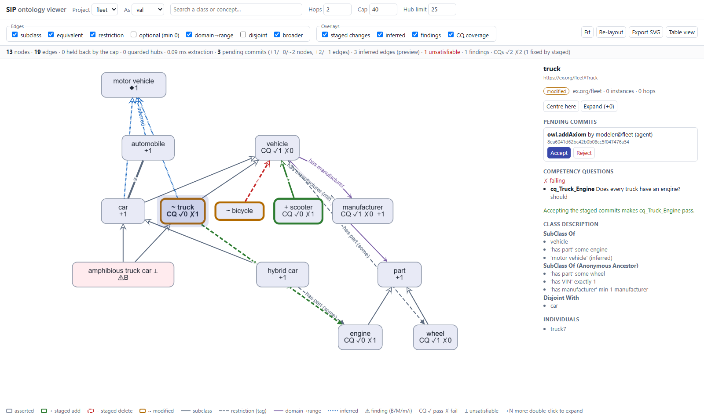

# Ontology visualization PoC (`ontoviz`)

This PoC is a search-first ontology viewer with **review-gate overlays**, built on SIP.
You type a class name, see its neighbourhood under a hard cap, and expand on demand
(hubs ask for confirmation first). The view then shows:

* **staged changes** from pending commits: `+` add, `−` delete, `~` modified, with
  **Accept** and **Reject** buttons;
* **inferred superclasses** from owlrl, reduced transitively;
* **unsatisfiable classes** (`⊥`);
* **quality findings**;
* **competency-question coverage**: pass, fail, and "fixed by the staged commits".

* Plan and pre-declared thresholds: [PLAN.md](PLAN.md)
* Measured results and findings: [RESULTS.md](RESULTS.md)
* Evidence base: [`knowledge/Ontology Visualization/reports/Ontology visualization for SIP.md`](../../../knowledge/Ontology%20Visualization/reports/Ontology%20visualization%20for%20SIP.md)



## Run

From this folder:

```bash
python -m ontoviz.server            # fleet demo -> http://127.0.0.1:8765/viz
python -m ontoviz.server --fibo     # plus FIBO (~20 s to load; cached in data/fibo.nt)
python -m pytest tests -q           # 15 offline tests, ~5 s
python -m ontoviz.bench extract     # server-side benchmark -> artifacts/bench_extract.json
python -m ontoviz.bench browser     # headless Chrome/Edge, 3 runs -> artifacts/bench_browser.json
```

* **URL parameters:** `?project=fibo&seed=<IRI>&as=<principal>`.
* **Interaction:** double-click a node to expand it, and click it for details.
* **Other views:** SIP's own workbench is still served at `/ui`, and the API docs at `/docs`.

## How it fits SIP

```
browser (web/index.html + app.js, vendored Cytoscape.js)
   |  POST /projects/{p}/ops/viz.*   X-SIP-Principal
   v
semantic_intelligence.api.app.create_app   <- SIP's own FastAPI app (server.py adds /viz)
   |  Platform.call  (PDP check, VocBench capability "rdf" R)
   v
ontoviz.sip_ops  viz.neighbourhood | viz.search | viz.individuals | viz.exportSVG | viz.stats
   |  per-revision cache: indexes of the stable / staged / union views
   v
index.py (typed TBox edges) -> neighbourhood.py (DOI, cap, hub guard) -> overlays.py -> contract.py / svg.py
```

* **Only through `Platform.call`.** The operations are registered with SIP's own
  `@operation` decorator, so they get the PDP check, show up in `GET /operations`, and use
  the generic route.
* **Data comes from existing SIP state:**
  * the stable and staged views come from `ctx.ontology(staged=…)`;
  * pending commits come from the change tracker;
  * the inferred graph comes from `ctx.reasoner.last`, or from `ctx.preview` for a staged
    preview;
  * findings come from `icv.run_checks`;
  * CQs come from the `cq` graph via `quality.cq.terms`.
* **The payload** is a superset of the Ontology-Playground `Ontology` JSON. Every SIP
  addition sits under `sip` keys, and the Playground's `Ontology.from_dict` accepts it
  (there is a test for this).
* **The demo platform** (`demo.py`) builds a *fleet* project in review:
  * stable content, accepted by a validator;
  * three commits from the machine principal `modeler@fleet`, left staged;
  * owlrl classification, both stable and as a staged preview;
  * an unsatisfiable class and classes without labels;
  * four CQs.

## Modules

| File | Role |
|---|---|
| `ontoviz/index.py` | Typed TBox edges. Kinds: `subClassOf`, `equivalentClass`, `restriction`, `optional` (`min 0`), `objectProperty`, `disjointWith`, `broader`. Restrictions are tagged edges; anything more nested becomes a Manchester-text badge |
| `ontoviz/neighbourhood.py` | Degree-of-interest expansion, best first, under `cap`, with the hub guard (`hub_limit`, `expand`) |
| `ontoviz/overlays.py` | Staged state, transitively reduced inferred edges, findings, CQ coverage |
| `ontoviz/contract.py` | The Playground-superset JSON |
| `ontoviz/svg.py` | Deterministic layered SVG for PRs, release notes and RESULTS. No cairo or Graphviz |
| `ontoviz/sip_ops.py` | The `viz.*` operations |
| `ontoviz/server.py` | SIP's app plus `/viz`, `/viz/static`, `/viz/bench` |
| `ontoviz/bench.py` | Extraction and headless-browser benchmarks |
| `web/` | `index.html`, `app.js`, `style.css`, `bench.html`, `vendor/` |

## Vendored JavaScript (no build step, offline)

| File | Package | Licence | SHA-256 |
|---|---|---|---|
| `web/vendor/cytoscape.min.js` | cytoscape 3.34.4 | MIT | `081591ab735b2b6a3b31a3c60f8f3a3e2fee8c92939e0c7820ad1208571b6cd8` |
| `web/vendor/cytoscape-dagre.js` | cytoscape-dagre 4.0.1 (bundles @dagrejs/dagre) | MIT | `d7ce98b7addb74a53df03b58c743266b6abd3d85b0e428d255e9285cde3de8c0` |

The licence texts are in `web/vendor/LICENSE-*.txt`. These files are not updated
automatically: to update one, download it, replace it, and record the new version and
checksum here.

**Deliberately excluded:**
* elkjs (EPL/GPL);
* Reactodia (LGPL, and it needs a React build);
* the FalkorDB Browser (SSPL);
* Cosmograph (non-commercial);
* Neo4j's visualization library (licensed for Neo4j products only).

## Design decisions worth knowing

* **Layout.** Generalisation points up. Restriction fillers and ranges are pushed *below*
  the class through temporary, reversed layout-only edges. The fit never zooms below a
  readable 0.85; the view centres on the seed instead.
* **Expanding** a node keeps every placed node where it is, and the new nodes ring the
  expanded one, to preserve the user's mental map.
* **The SVG export does not reuse** `capabilities/architecture/graphrag_agent/sysml_diagrams.py`.
  That renderer ties edge colours to SysML semantics (`satisfy`/`verify`/`flow`), so a
  small layered renderer of its own was simpler than adapting it.
* **A table view** (accessibility) and SVG export are in the toolbar.
