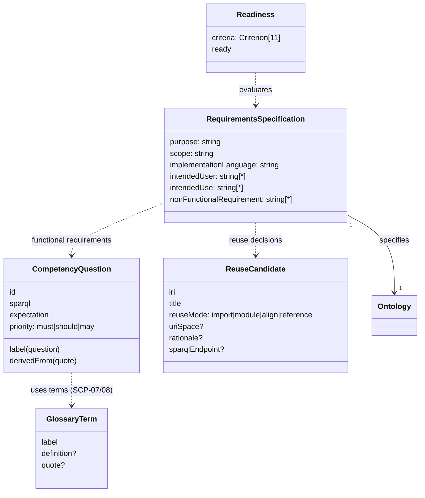
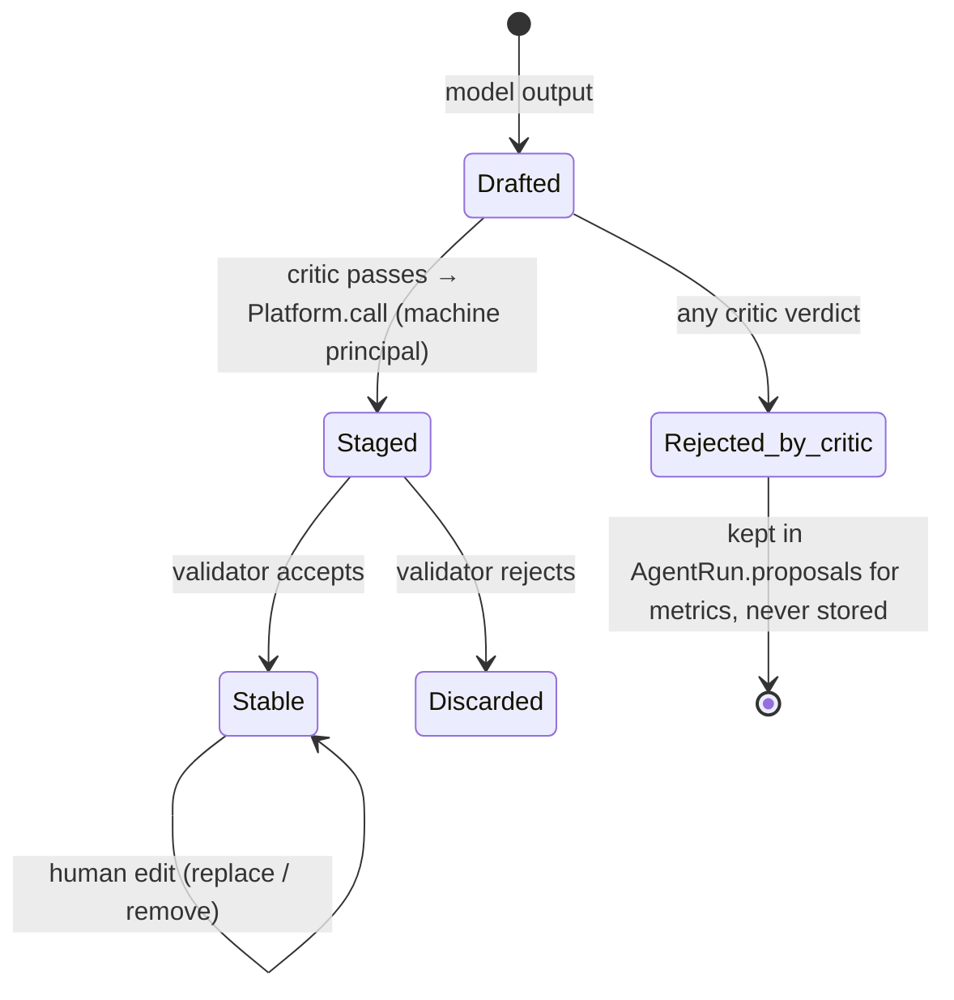
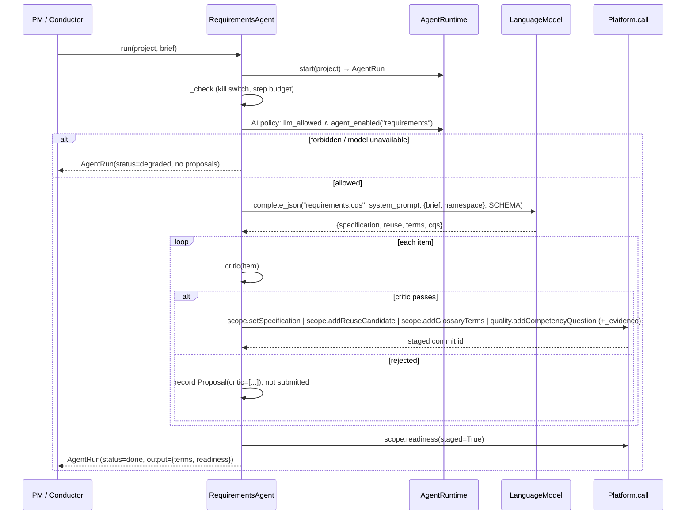
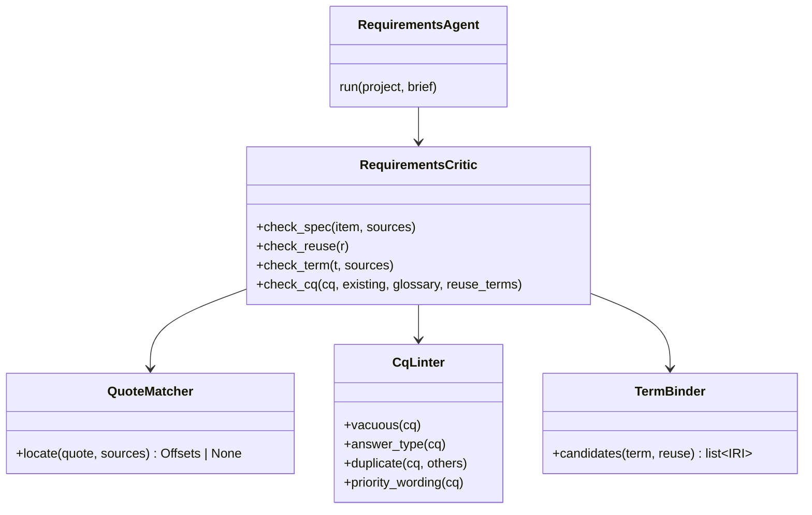
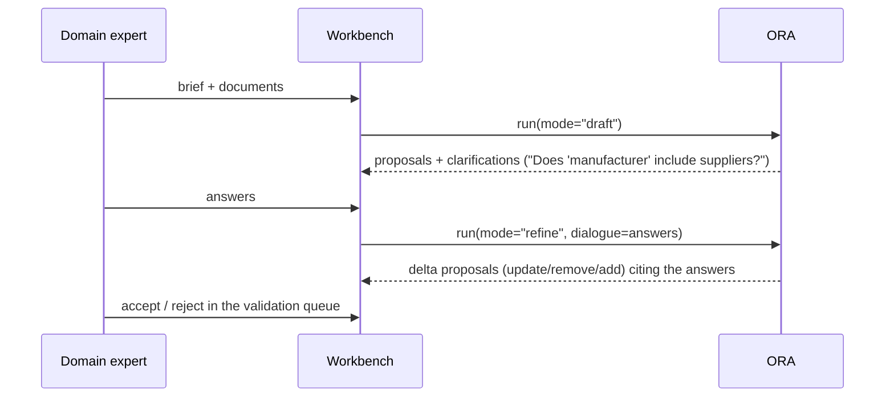

# Ontology Requirements Agent (ORA): Specification

**Status:** as-built R0 described and verified · target R1–R3 specified · 2026-10-20
**Lifecycle stage:** `scope` (stage 1 of `scope → acquire → model → validate → review ║ populate → reason → publish ║ consume`)
**Code:** [`agents/specialists.py`](../../semantic_intelligence/agents/specialists.py) (`RequirementsAgent`) ·
[`scope/orsd.py`](../../semantic_intelligence/scope/orsd.py) · [`quality/cq.py`](../../semantic_intelligence/quality/cq.py) ·
[`agents/base.py`](../../semantic_intelligence/agents/base.py) · [`agents/simulators.py`](../../semantic_intelligence/agents/simulators.py) (`sim_requirements`)
**Tests:** [`tests/test_scope.py`](../../semantic_intelligence/tests/test_scope.py)
**Architecture:** [ARCHITECTURE_DESCRIPTION.md](../ARCHITECTURE_DESCRIPTION.md) §agents (row *RequirementsAgent*) · SysML
`sip_requirements` (FR-SCP-01..03, FR-AG-01/02), `sip_functional` (`RequirementsAgent :> SpecialistAgent`), `sip_behaviour` (`action scope`)

This document specifies the agent end to end:
* **Part I, design:** purpose, principles, use cases, information model, architecture,
  interfaces and critic rules.
* **Part II, implementation:** how R0 is built, verified against the code, with its known
  defects and limits.
* **Part III, target design:** R1–R3.
* **Part IV, verification:** evaluation, test specification and traceability.

Every statement about the as-built agent was checked against the code and a run on
2026-10-20 (Appendix B). Target features are marked **[target]**.

---

## Contents

**Part I: Design**
1. Purpose
2. Scope
3. Design principles
4. Stakeholders, use cases and run modes
5. Information model
6. Architecture
7. Interfaces
8. Processing pipeline
9. Critic rule catalogue
10. Scope exit criteria
11. Governance, security and AI policy
12. Non-functional requirements

**Part II: Implementation**

13. As-built implementation (R0)
14. Known defects and limitations

**Part III: Target design**

15. Target design and roadmap (R1–R3)

**Part IV: Verification**

16. Evaluation
17. Test specification
18. Traceability
19. Open decisions and risks

**Appendices**
* A. Model output schema
* B. Worked example
* C. System prompt
* D. Glossary

---

# Part I: Design

## 1. Purpose

The Ontology Requirements Agent turns what stakeholders say they need into a **reviewable,
executable requirements specification** for an ontology. It answers the question that
starts every ontology project:

> *What must this ontology be able to answer, for whom, under which constraints, and how
> will we know it does?*

Its product is the project's **Ontology Requirements Specification Document (ORSD)**, in
NeOn's structure (Suárez-Figueroa, Gómez-Pérez & Villazón-Terrazas, 2009):

| ORSD part | Content |
|---|---|
| 1. Purpose | |
| 2. Scope | the domain covered |
| 3. Implementation language | |
| 4. Intended end-users | |
| 5. Intended uses | |
| 6a. Non-functional requirements | |
| 6b. Functional requirements | prioritised **competency questions** (CQs) |
| 7. Pre-glossary of terms | |
| 8. Reuse candidates | added by SIP |

SIP adds one thing NeOn doesn't have: **every CQ carries an executable SPARQL test and an
expectation.** Requirements are therefore tests from the first day, and the release gate
can enforce them (FR-QA-02).

Why an agent: drafting an ORSD by hand is slow, and most teams skip it. The agent produces a
complete first draft in seconds. It never decides: every item quotes the source it rests on,
a deterministic critic removes anything ungrounded or malformed, and a human accepts or
rejects each item in SIP's validation queue.

## 2. Scope

**In scope**
* Drafting all ORSD fields from a natural-language brief. R0 works from a single brief;
  multiple sources are R2.
* Proposing reuse candidates (existing ontologies or datasets), each with a reuse mode and a
  rationale.
* Proposing a pre-glossary of domain terms the sources use.
* Proposing prioritised CQs with SPARQL tests and expectations.
* Reporting the scope stage's exit criteria (readiness) on the staged view.
* **[target]** Clarifying questions for stakeholders, multi-source elicitation, term binding
  to reuse ontologies, change impact when requirements change.

**Out of scope** (and owned elsewhere)

| Not done by this agent | Owner |
|---|---|
| Creating classes, properties or axioms | ExtractionAgent (acquire), ModelingCopilot (model) |
| Judging the *ontology's* quality | QualityAgent / Ontology Validation Agent (validate) |
| Accepting or rejecting proposals | human validator (review gate) |
| Running CQs against the ontology | release gate (`quality.releaseGate`), CQ discrimination check (`quality.checkCompetencyQuestions`) |
| Defining the project's languages, model type, base URI | project manager (governance) |

## 3. Design principles

| # | Principle | Consequence in this agent |
|---|---|---|
| P1 | **Grounded or dropped** | Every proposed item carries a verbatim quote from the source. An item whose quote is missing or not verbatim never reaches the store (critic RQ-C01/C02). |
| P2 | **The model never decides** | The model only drafts. A deterministic critic filters, and only a human makes content stable. The agent's machine principal cannot validate (QR-SEC-02). |
| P3 | **Everything is RDF** | The ORSD lives in named graphs (`metadata`, `cq`), versioned with the ontology, queryable, exportable. |
| P4 | **Requirements are tests** | A CQ without an executable SPARQL test and a well-formed expectation is not a requirement (RQ-C06..C08). |
| P5 | **A test must be able to fail** | Vacuous CQs are worthless. R0 relies on the downstream discrimination check (FR-QA-03); **[target]** R1 pre-checks at proposal time (RQ-C10). |
| P6 | **One operation surface** | All reads and writes go through `Platform.call` under the agent's machine principal. The PDP, history and staging apply to the agent like to any user. |
| P7 | **Offline by default, degradable** | It runs on a deterministic simulator unless `SIP_MODEL` opts in to a live model. If the model is unavailable or forbidden, the run degrades to "no proposals" and the stage stays completable by hand (QR-AVL-02). |
| P8 | **Bounded autonomy** | AI policy, step and token budgets and a kill switch bound every run (QR-AIT-02). One model call per run in R0. |
| P9 | **Transparent provenance** | Every staged commit carries an evidence record: agent, run, model, prompt hash, confidence, rationale, quote, on-behalf-of, `ai_generated: true` (QR-REG-01, QR-AIT-01). |
| P10 | **Measured assistance** | Proposals, critic rejections, human acceptances and cost are counted per agent (QR-AIT-03), so the agent's usefulness is a number, not a claim. |

## 4. Stakeholders, use cases and run modes

**Stakeholders**

| Stakeholder | Concern | What they get from ORA |
|---|---|---|
| Project manager | Start fast; know when scope is "done" | a draft ORSD and the readiness report (SCP-01..11) |
| Domain expert | Being understood; not having to learn OWL | requirements in their own words, quoted back; clarifying questions **[target]** |
| Ontologist | A precise target to model against | executable CQs; a pre-glossary; reuse candidates |
| Validator | Deciding quickly and safely | each proposal with its quote, rationale and critic verdicts |
| Release manager | Releases that meet requirements | `must` CQs enforced by the release gate |
| Auditor / regulator | Traceability of AI contributions | evidence records and history per commit |

**Use cases**

| ID | Use case | Status |
|---|---|---|
| UC-1 | **Brief → draft ORSD.** A PM pastes a project brief; ORA proposes specification fields, reuse candidates, glossary and CQs; the validator accepts or rejects them. | R0 |
| UC-2 | **Readiness check.** After the run (and after each human edit), the scope exit criteria show what is still missing. | R0 |
| UC-3 | **ORSD export.** The specification is exported as a NeOn-structured Markdown document for sign-off (`scope.exportSpecification`). | R0 (platform) |
| UC-4 | **Template-seeded scope.** A project created from a template starts with seeded non-functional requirements and reuse candidates; ORA adds to them. | R0 (platform) |
| UC-5 | **Multi-source elicitation.** Several sources (brief, meeting notes, regulations, existing reports) are read; each item cites its source and character offsets. | [target] R2 |
| UC-6 | **Clarification dialogue.** ORA proposes clarifying questions where the sources are vague or contradictory ("Does *manufacturer* include suppliers?"); answers become sources. | [target] R2 |
| UC-7 | **Reuse-aware terms.** Glossary terms and CQ vocabulary are linked to candidate terms in the reuse ontologies (e.g. FIBO `hasLegalName`). | [target] R1 |
| UC-8 | **Requirement change impact.** When a requirement changes, the affected CQs, terms and downstream axioms are listed. | [target] R3 |

**Run modes**

| Mode | How it starts | Notes |
|---|---|---|
| Pipeline | `Conductor.run(project, human, brief=…)` runs ORA as the `scope` step | R0; readiness reported, not enforced |
| Direct | `RequirementsAgent(runtime, principal).run(project, brief)` | R0; used by tests and the workbench |
| UI | Workbench "Draft with RequirementsAgent" button (`api/workbench.html`) | R0 |
| Interactive | elicitation dialogue with stakeholders | [target] R2 |

## 5. Information model

### 5.1 Entities



### 5.2 RDF representation

| Entity | Graph | Subject IRI | Type and key predicates |
|---|---|---|---|
| Specification | `urn:sip:p:{p}:metadata` | `urn:sip:p:{p}:orsd` | `sip:RequirementsSpecification`; `sip:specifies` (project base IRI), `sip:purpose`, `sip:scope`, `sip:implementationLanguage`, `sip:intendedUser`*, `sip:intendedUse`*, `sip:nonFunctionalRequirement`* |
| Reuse candidate | `metadata` | the candidate's own IRI | `void:Dataset`, `sip:ReuseCandidate`; `dcterms:title`, `sip:reuseMode`, `void:uriSpace`, `sip:rationale`, `void:sparqlEndpoint` |
| Glossary term | `urn:sip:p:{p}:cq` | `urn:sip:term:{slug(label)}` | `sip:GlossaryTerm`; `rdfs:label@en`, `skos:definition@en`, `sip:quote` |
| Competency question | `cq` | `urn:sip:cq:{id}` | `sip:CompetencyQuestion`; `rdfs:label@en` (question), `sip:sparql`, `sip:expectation`, `sip:priority`, `sip:derivedFrom` (quote) |
| Proposal (staged) | `{content}:staging-add` / `:staging-del` | as above | a triple in a staging graph *is* a proposal; no status flag on content |
| Evidence | commit record in `urn:sip:p:{p}:history` | commit IRI | agent, run, model, prompt hash, confidence, rationale, quote, on-behalf-of, `ai_generated` |

Notes:
* Single-valued fields are *replaced* by `scope.setSpecification`. List fields are replaced
  as a whole set (`orsd.spec_delta`).
* `implementation_language` is not stored until someone sets it. When it is empty, reads
  derive it from the project model type (OWL → "OWL 2", SKOS → "SKOS", …).
* Term comparison for SCP-07/08 ignores case, spacing, camel case and a plural "s"
  (`orsd._key`).

### 5.3 Item lifecycle



## 6. Architecture

### 6.1 Placement

```mermaid
flowchart LR
  subgraph Inputs
    B[Project brief]:::in
    S[[sources: notes, regulations · target]]:::in
  end
  subgraph Agent_layer[Agent layer]
    ORA[RequirementsAgent\nmachine principal requirements@p\nrole agent-ontology-copilot]
    CR[Critic\nRQ-C01..C09 · R1: C10..C18]
    LM[(LanguageModel\nSimulatedModel | ClaudeModel)]
  end
  subgraph Platform[Platform.call: the single entry point]
    PDP{PDP\nVocBench capabilities}
    OPS[scope.* · quality.addCompetencyQuestion · scope.readiness]
    CT[ChangeTracker\nmachines always staged]
  end
  subgraph Store[Named graphs]
    MG[(metadata)]
    CQ[(cq)]
    HG[(history + evidence)]
  end
  V[Validator\nvalidation queue]:::h
  B --> ORA
  S -.-> ORA
  ORA <--> LM
  ORA --> CR --> PDP --> OPS --> CT --> MG & CQ & HG
  V -->|accept / reject| CT
  classDef in fill:#eef,stroke:#88a
  classDef h fill:#efe,stroke:#8a8
```

### 6.2 Run sequence (R0)



### 6.3 Trust boundary

| Can the model…? | Answer | Enforced by |
|---|---|---|
| …write to stable content? | **No.** Every write is a staged proposal. | `ChangeTracker.commit` stages machine principals unconditionally |
| …accept its own proposals? | **No.** Validation needs `V` rights the agent role lacks. | PDP (QR-SEC-02) |
| …introduce an item that isn't in the source? | **No** (as far as verbatim quoting can tell) | critic RQ-C01/C02/C05 |
| …store a malformed CQ? | **No.** Parse, expectation and priority are checked. | critic RQ-C06..C08 and `quality.addCompetencyQuestion` guards |
| …choose a wrong but *grounded* interpretation? | **Yes.** That is the residual risk the human validator covers. | review gate; R1 entailment judge (advisory) |

## 7. Interfaces

### 7.1 Agent API

```python
class RequirementsAgent(Agent):
    name   = "requirements"
    stage  = "scope"
    roles  = ("agent-ontology-copilot",)

    def run(self, project: str, brief: str) -> AgentRun: ...
```

* **Input.** `project` is an existing project id. `brief` is UTF-8 text; R0 has no length
  limit beyond the token budget.
* **Output.** An `AgentRun` (`agents/base.py`):
  * `status` is `done`, `degraded`, `stopped` or `failed`;
  * `proposals` is a list of `Proposal(operation, arguments, rationale, evidence,
    confidence, critic, commit, error)`;
  * `output` is `{"terms": [label…], "readiness": Readiness.as_dict()}`;
  * `summary()` gives counts: proposed, submitted, rejected by the critic, errors, model
    calls, steps.
* **[target R2]** `run(project, sources: list[Source], *, mode="draft"|"refine",
  dialogue: list[Turn] | None = None)`, where `Source = {id, title, kind, text}`.

### 7.2 Model contract

| Aspect | R0 |
|---|---|
| Task id | `requirements.cqs` |
| System prompt | stable per agent (cacheable). The full text is in Appendix C. |
| User prompt | `json.dumps({"brief": brief, "namespace": <project default namespace>})` |
| Output | one JSON object conforming to `RequirementsAgent.SCHEMA` (Appendix A). The live model uses structured outputs (`output_config.format` = JSON schema), so the shape is guaranteed. The critic checks the content. |
| Model | `SimulatedModel` (default, offline) or `ClaudeModel` (`SIP_MODEL=claude-opus-5-5`; adaptive thinking, effort `high`, prompt caching, server-side refusal fallback) |
| Calls per run | 1 |
| Failure handling | `ModelRefusal`, `RuntimeError` (truncation, no text), `KeyError` (no simulator), `ConnectionError` lead to `status=degraded`, no proposals |

### 7.3 Platform operations used

| Operation | Capability (VocBench) | CRUDV | Graph | Effect | Guard (second line of defence) |
|---|---|---|---|---|---|
| `scope.setSpecification` | `rdf(ontology, metadata)` | U | metadata | replace given fields | unknown field or no field raises ValueError |
| `scope.addReuseCandidate` | `rdf(ontology, metadata)` | C | metadata | add a `void:Dataset` | mode ∉ {import, module, align, reference}, a non-absolute IRI or an empty title raise ValueError |
| `scope.addGlossaryTerms` | `rdf(resource, cq)` | C | cq | add terms `{label, definition?, quote?}` | empty label raises ValueError |
| `quality.addCompetencyQuestion` | `rdf(resource, cq)` | C | cq | add a CQ | bad expectation or priority raises ValueError. Unparseable SPARQL is *allowed* (it fails SCP-06 until fixed) |
| `scope.readiness` | `rdf` | R | metadata + cq (staged view) | exit criteria | none |

The agent's role `agent-ontology-copilot` grants `rdf(resource)` CRUD,
`rdf(resource,_)` CRUD and `rdf` R. It has no `V`, so it can never validate.

### 7.4 Evidence record

Every staged commit stores this evidence record:

```json
{"agent": "requirements", "run": "<run id>", "model": "simulated | claude-…",
 "prompt_hash": "<sha256/16>", "confidence": 0.7, "rationale": "<why>",
 "on_behalf_of": "<human who enabled the agents>", "ai_generated": true,
 "quote": "<verbatim span>", "quotes": ["…"] }
```

`quotes` appears only for list fields, where several items are batched into one proposal.

## 8. Processing pipeline

The R0 algorithm (`RequirementsAgent.run`):

```text
run ← start(project); ns ← project.default_namespace
out ← ask("requirements.cqs", {brief, namespace: ns}, SCHEMA)        # 1 model call
if out is None: return finish(run)                                   # degraded

grounded(item) := [] if item.quote ∈ brief (exact substring) else
                  ["no quote from the brief"] if not item.quote else
                  ["quote is not verbatim from the brief"]

# 1. single-valued fields: one proposal each, only if text non-empty
for f in (purpose, scope):
    if out.specification[f].text: submit(setSpecification{f: text}, critic=grounded(item))

# 2. list fields: rejected items recorded (never submitted); grounded items batched
for f in (intended_users, intended_uses, non_functional):
    ok ← [i for i in items if text(i) and grounded(i)=[]]
    record rejected items with their verdicts
    if ok: submit(setSpecification{f: [i.text for i in ok]}, quotes=[i.quote])

# 3. reuse candidates: one proposal each
for r in out.reuse:
    critic ← grounded(r) + [mode ∉ REUSE_MODES] + [iri !~ ^https?://\S+$]
    submit(addReuseCandidate{iri, title, mode, uri_space=iri, rationale}, critic)

# 4. pre-glossary: dedupe, then keep a term only if the brief contains it
sentences ← split brief on [.!?] / newlines
for t in unique(out.terms):
    quote ← first sentence containing t (case-insensitive)
    if none: record rejected("term t does not occur in the brief")
    else keep {label: t, quote}
if kept: submit(addGlossaryTerms{terms: kept})                       # one proposal

# 5. competency questions: one proposal each
for cq in out.cqs:
    q ← cq.sparql if it starts with PREFIX else standard prefixes(:, rdf, rdfs, owl, skos) + cq.sparql
    priority ← lower(cq.priority or "must")
    critic ← cq.problems(id, question, q, expectation, priority)     # parse, expectation, priority
             + ["quote is not verbatim from the brief"] if quote ∉ brief
    submit(addCompetencyQuestion{id: sanitize(cq.id), question, sparql: q,
                                 expectation, priority, source: quote}, critic)

readiness ← read("scope.readiness", staged=True)
return finish(run, {terms: [labels], readiness})
```

Ordering is deterministic (the model output order), and the confidence is constant (0.7)
in R0. Every `submit` and the `ask` count as one step against `max_steps_per_run`.

## 9. Critic rule catalogue

Rules carry IDs so findings, tests and metrics can name them. "Stage" says where the rule
runs: in the agent's critic (C), or in the platform operation as a second line of defence
(P).

| ID | Applies to | Rule | Stage | Status |
|---|---|---|---|---|
| RQ-C01 | all items | a quote is present | C | R0 |
| RQ-C02 | spec fields, list items, reuse, CQs | the quote is an exact substring of the brief | C | R0 |
| RQ-C03 | reuse | mode ∈ {import, module, align, reference} | C + P | R0 |
| RQ-C04 | reuse | the IRI is absolute http(s) (C) / http(s) or urn (P) | C + P | R0 (C stricter than P, see DEF-04) |
| RQ-C05 | glossary | the term occurs in the brief (case-insensitive); its quote is the first sentence containing it | C | R0 |
| RQ-C06 | CQ | the SPARQL parses (after prefix injection) | C (P allows it, SCP-06 catches it) | R0 |
| RQ-C07 | CQ | expectation ∈ `non-empty` \| `empty` \| `count>=N` \| `ask:true\|false` \| `contains:<IRI>` | C + P | R0 |
| RQ-C08 | CQ | priority ∈ {must, should, may} | C + P | R0 |
| RQ-C09 | spec fields | empty `text` is dropped, not proposed | C | R0 |
| RQ-C10 | CQ | **not vacuous:** a non-negative CQ must not pass on an empty graph (`cq.discrimination`'s empty-graph test, run at proposal time) | C | R1 |
| RQ-C11 | CQ | **term coverage:** every project-namespace term a CQ uses is in the proposed pre-glossary or bound to a reuse-ontology term | C | R1 |
| RQ-C12 | CQ | **no duplicates:** the normalised question differs from every existing and proposed CQ (SCP-11 at proposal time) | C | R1 |
| RQ-C13 | CQ | **answer type matches the question form:** "which/what/who/how many" leads to SELECT (count for "how many"); "is/does/are" leads to ASK | C | R1 |
| RQ-C14 | CQ | **priority matches the wording:** the quote contains must/shall/required → `must`; should/ideally/nice → `should`/`may`. A mismatch is reported, the priority is not changed. | C (advisory) | R1 |
| RQ-C15 | reuse | the IRI is in the reuse registry, or resolvable via the registry's offline catalogue (no network call at run time) | C (advisory) | R1 |
| RQ-C16 | all | **normalised quote matching:** whitespace, typographic quotes and dashes normalised; the character offsets are recorded | C | R1 (replaces the exact-substring check, keeps its strictness) |
| RQ-C17 | non-functional | the NFR is measurable or testable (a number, a standard, a language code, a named licence). Otherwise flagged "make it testable". | C (advisory) | R1 |
| RQ-C18 | all | **entailment judge:** an LLM judge, calibrated on seeded wrong items, labels whether the quote supports the item. Advisory only; the verdict is shown to the validator, never used to submit or drop. | C (advisory) | R2 |
| RQ-C19 | CQ id | the sanitised id doesn't collide with an existing CQ with different content; a collision becomes an explicit *update* proposal (see DEF-01) | C + P | R1 |

**Severity semantics.**
* Blocking rules (C01–C09, C10–C13, C16, C19) prevent submission.
* Advisory rules (C14, C15, C17, C18) are attached to the proposal evidence and shown to the
  validator.

## 10. Scope exit criteria

Defined in `orsd.readiness`. ORA reports them on the **staged** view at the end of the run.
The same function on the **stable** view decides whether the scope stage can close. The
conductor reports readiness and does not enforce it, so the stage stays completable by hand.

| ID | Kind | Criterion | ORA's contribution |
|---|---|---|---|
| SCP-01 | required | purpose stated | proposes `purpose` |
| SCP-02 | required | scope stated | proposes `scope` |
| SCP-03 | required | ≥ 1 intended end-user | proposes `intended_users` |
| SCP-04 | required | ≥ 1 intended use | proposes `intended_uses` |
| SCP-05 | required | ≥ 1 CQ with priority `must` | proposes CQs with priorities |
| SCP-06 | required | every CQ executable (parses, valid expectation and priority) | critic RQ-C06..C08 |
| SCP-07 | advisory | every CQ term is in the pre-glossary | proposes the glossary; R1 RQ-C11 |
| SCP-08 | advisory | every glossary term is used by a CQ | — (R1: warn on orphan terms) |
| SCP-09 | advisory | non-functional requirements stated | proposes `non_functional` |
| SCP-10 | advisory | reuse candidates recorded | proposes reuse candidates |
| SCP-11 | advisory | no duplicate CQs | R1 RQ-C12 |

"Ready" means all required criteria are met. Readiness on the staged view can be `true`
while the stable view is `false`, because nothing has been accepted yet. UIs must label which
view they show.

## 11. Governance, security and AI policy

| Concern | Mechanism |
|---|---|
| Identity | one machine principal per project, `requirements@{project}`, `is_machine=True`, `on_behalf_of=<human who enabled agents>` (created by `Conductor.enable_agents`) |
| Authorisation | the role `agent-ontology-copilot`, checked by the PDP on every call. A denied call becomes `Proposal.error` (`AuthorizationError`), never a crash. |
| Staging | machine commits are always staged, whatever the project's validation setting |
| Validation | humans only. Accepted commits become stable; rejected ones are discarded. |
| AI policy | `AiPolicy(llm_allowed, enabled_agents, max_tokens_per_run=200k, max_steps_per_run=50, inference_geo)`, checked before every model call. The decision is logged in `AgentRuntime.policy_log`. |
| Kill switch | `AgentRuntime.stop(run_id)`: the next step raises `RunStopped` and the status becomes `stopped` |
| Budgets | step budget (every `ask` and `submit`); token budget for live models |
| Data handling | the brief is sent to the model provider only when `llm_allowed` and the agent is enabled. `inference_geo` pins the region **[platform]**. Briefs containing personal or confidential data need a project policy decision. **[target R1]** PII pre-scan (RQ-C20, below). |
| Provenance | evidence record per commit (§7.4); history graph; model id and prompt hash make every proposal reproducible with the simulator |
| Transparency | `ai_generated: true` on every agent commit (QR-REG-01). The ORSD export can list AI-originated items **[target R1]**. |

**[target R1]** RQ-C20, PII pre-scan: before the model call, detect e-mail addresses,
phone numbers, national identifiers and names from a project deny-list. Depending on policy,
the agent either redacts them (the quote check then runs against the redacted text) or
degrades.

## 12. Non-functional requirements

| ID | Requirement | R0 | Target |
|---|---|---|---|
| ORA-NFR-01 | **Determinism (offline):** the same brief, model and project state give the same proposals | yes (simulator) | keep; live runs record the prompt hash |
| ORA-NFR-02 | **Latency:** time to first proposal | < 0.1 s simulator; one live call ≈ 5–20 s | P95 < 30 s for briefs ≤ 5k words |
| ORA-NFR-03 | **Cost:** one call per run | ≈ 3–8k input tokens, 1–3k output | report USD per run in `AgentRun` |
| ORA-NFR-04 | **Scale:** brief size | bounded by the context window and token budget | R2: chunked multi-source with per-source offsets; ≥ 50 pages |
| ORA-NFR-05 | **Idempotence:** re-running the same brief changes nothing | partly: spec fields, reuse and terms are idempotent; **CQs with the same id merge** (DEF-01) | full: re-runs give no-op or explicit update proposals |
| ORA-NFR-06 | **Robustness:** a budget, policy or model failure never leaves a half-finished run unreported | **no** (DEF-02) | runs finish with `status` and partial output |
| ORA-NFR-07 | **Groundedness invariant:** 100% of submitted items quote the source verbatim | yes (by construction) | keep; add offsets |
| ORA-NFR-08 | **Languages:** briefs in project languages | English assumed by the simulator; the live model is language-agnostic | R2: language-aware term matching (lemmatisation) |
| ORA-NFR-09 | **Availability:** scope is completable without the model | yes | keep |

---

# Part II: Implementation

## 13. As-built implementation (R0)

### 13.1 File map

| File | Symbol | Responsibility |
|---|---|---|
| `agents/specialists.py` | `RequirementsAgent` (`name`, `stage`, `roles`, `description`, `system_prompt`, `SCHEMA`, `run`) | the agent: prompt, schema, critic, submissions |
| `agents/specialists.py` | `_QUOTED`, `_QUOTED_LIST`, `_obj`, `_STR` | JSON-schema helpers (`additionalProperties: false`, all properties required) |
| `agents/base.py` | `Agent`, `AgentRun`, `AgentRuntime`, `Proposal`, `BudgetExceeded`, `RunStopped` | run lifecycle, policy check, budgets, evidence, metrics |
| `agents/llm.py` | `ClaudeModel`, `SimulatedModel`, `default_model`, `prompt_hash` | model providers; offline unless `SIP_MODEL` is set |
| `agents/simulators.py` | `sim_requirements`, `KNOWN_ONTOLOGIES`, `_SOFT` | deterministic offline drafting (patterns below) |
| `agents/orchestrator.py` | `Conductor.run(... brief=...)` → `scope` step; `Conductor.enable_agents` | pipeline integration; machine principals |
| `scope/orsd.py` | `Specification`, `spec_delta`, `ReuseCandidate`, `GlossaryTerm`, `cq_terms`, `readiness`, `render_markdown`, `REUSE_MODES` | the ORSD model, exit criteria, export |
| `quality/cq.py` | `CompetencyQuestion`, `problems`, `run_cq`, `discrimination`, `release_gate` | CQ model, executability, vacuity, release gate |
| `platform.py` | `scope.*` operations, `quality.addCompetencyQuestion`, `_scope_state` | the guarded operation surface |
| `governance/capabilities.py` | role `agent-ontology-copilot` | the agent's capabilities |
| `api/workbench.html` | "Draft with RequirementsAgent" | UI entry point |

### 13.2 The offline simulator (`sim_requirements`)

It is deterministic and pattern-based, sentence by sentence. It exists so the pipeline, the
critic and the tests run without a model. It is **not** a requirements-engineering method.

| Sentence pattern | Produces |
|---|---|
| `<X> needs/wants/requires an ontology of/for/about/covering <Y>` | purpose = sentence, scope = Y, intended user = X |
| mentions a known ontology (`schema.org`, `fibo`, `owl-time`, `dublin core`, `qudt`, `geonames`) **and** reuse/align/import/based on | reuse candidate (mode from the wording: import, align, or the registry default) |
| `must/should be available/published/provided/expressed/compatible/licensed/documented` | non-functional requirement |
| `every/each/all <A> has/have/must have [one or more / at least one] <B>` | terms A, B; CQ `cq_A_B`: ASK for `:A ⊑ ∃p.:B` (deliberately not `rdfs:subClassOf*`, which is vacuous) |
| `we need to know / track / record which/what <A>` | term A; intended use = sentence; CQ `cq_A`: SELECT instances of `:A` |
| soft wording (should, ideally, nice to have, could, may) | priority `should`, otherwise `must` |

### 13.3 Configuration

| Setting | Where | Default |
|---|---|---|
| Live model | env `SIP_MODEL` (`simulated` \| `claude-opus-5-5` \| `auto`) | `simulated` |
| AI policy | `ProjectConfig.ai_policy` | LLM allowed, all agents, 50 steps, 200k tokens |
| Namespace for CQs | project `default_namespace` (`:` prefix) | from `base_uri` |
| Confidence | constant in code | 0.7 |

### 13.4 Extension points

* **Swap the drafting model.** Register another simulator for `requirements.cqs`, or set
  `SIP_MODEL`.
* **Add critic rules.** Extend the per-item `critic` lists in `run`. R1 moves them into a
  `RequirementsCritic` class (§15.2).
* **Add sources.** R2 changes the prompt from `{brief}` to `{sources:[…]}` and the quote
  check to source-scoped offsets.

## 14. Known defects and limitations

Found while writing this specification; each was reproduced on 2026-10-20.

| ID | Severity | Finding | Reproduction | Fix (target) |
|---|---|---|---|---|
| **DEF-01** | major | **Duplicate CQ ids merge instead of replacing.** `quality.addCompetencyQuestion` adds triples to `urn:sip:cq:{id}` without removing the old ones. A second add with the same id leaves two labels and two `sip:sparql` values, and reads return one arbitrarily. A re-run of ORA on a revised brief that regenerates `cq_Manufacturer` corrupts the CQ. | add `cq1` twice with different SPARQL → 2 labels, 2 sparql | R1: the operation rejects an existing id with different content (or replaces it under an explicit `update=True`); ORA emits update proposals (RQ-C19). Test RQ-T22. |
| **DEF-02** | major | **Budget exhaustion escapes the run.** `BudgetExceeded`, raised by `_check` inside `submit`, isn't caught in `run`. The `AgentRun` stays `running` with no output, the proposals made so far remain staged, and `Conductor.run` aborts the whole pipeline. | `max_steps_per_run=5` with the test brief → `BudgetExceeded`, 4 commits pending | R1: catch `BudgetExceeded` and `RunStopped` in `Agent` (template method). The run finishes with `status="stopped"`, `output` keeps partial readiness and a note; the conductor continues. Test RQ-T18. |
| DEF-03 | minor | **Exact-substring quoting is brittle.** Any normalisation by the model (whitespace, typographic quotes, a dropped full stop) rejects a correct item. | quote "Labels must be available" with a double space | R1: RQ-C16, normalised matching plus offsets |
| DEF-04 | minor | **Critic and platform disagree on reuse IRIs.** The critic requires http(s); `ReuseCandidate` also accepts `urn:`. A legitimate URN reuse candidate can't be proposed by the agent. | reuse IRI `urn:x:y` → critic rejects; a human can add it | R1: align on one rule (http(s) \| urn), shared from `orsd` |
| DEF-05 | minor | **Glossary matching is substring-based.** "car" matches "carbon"; irregular plurals ("child" / "children") fail. | brief with "carbon"; term "car" → accepted | R1: token-boundary match plus lemmatisation (ORA-NFR-08) |
| DEF-06 | minor | **Glossary terms accumulate quotes.** Term IRIs are slugs of the label, so re-adding a term with another quote adds a second `sip:quote`. | add "vehicle" twice with different quotes | R1: replace semantics, as for DEF-01 |
| LIM-01 | design | **CQs name terms before the ontology exists.** `:Manufacturer` is a guess that modelling must then honour. | — | R1: the term binding table (UC-7); CQ vocabulary reconciled after modelling (the validate stage reports unresolved CQ terms) |
| LIM-02 | design | **CQ quality is checked late.** Vacuity and insensitivity (FR-QA-03) are checked only at the validate stage. | — | R1: RQ-C10 at proposal time |
| LIM-03 | design | **Single brief, single shot, no dialogue.** Gaps stay gaps until a human notices them. | — | R2: multi-source and clarifying questions (UC-5, UC-6) |
| LIM-04 | design | **`implementation_language` is never proposed**; it is derived from the project model type. | — | keep; R1 proposes it only if a source states it |
| LIM-05 | design | **Constant confidence (0.7)** carries no information. | — | R1: confidence from critic margins and advisory verdicts; R3 calibrated |

---

# Part III: Target design

## 15. Target design and roadmap

### 15.1 Releases

| Release | Theme | Content | Exit criterion |
|---|---|---|---|
| **R1 Hardening** | trustworthy single-source drafting | DEF-01..06 fixed; critic rules C10–C17, C19, C20; `RequirementsCritic` class; term binding to reuse ontologies (UC-7); confidence from critic margins; ORSD export marks AI-originated items | all R1 tests green; the groundedness invariant holds on the property-based fuzz suite; no vacuous `must` CQ proposed on the gold set |
| **R2 Elicitation** | from documents and people | multi-source input with offsets (UC-5); clarifying questions (UC-6) stored as open issues; the answers become sources; entailment judge C18 (advisory, κ-calibrated); language-aware matching | on the gold set, gold-CQ recall ≥ 0.6 at precision ≥ 0.7, human acceptance ≥ 0.7, cost per run reported |
| **R3 Measured evolution** | improve by evidence | evaluation set and harness (§16); prompt optimisation (GEPA) as a governed release; change-impact analysis (UC-8); calibrated confidence | gains beat run-to-run noise on a held-out split; release-gate approval |

### 15.2 R1 component design



* **`QuoteMatcher`** normalises whitespace, quotes and dashes and returns
  `{source_id, start, end}`. It is strict: there is no fuzzy matching beyond normalisation.
* **`CqLinter`** reuses `cq.discrimination`'s empty-graph test, plus question-form
  heuristics.
* **`TermBinder`** uses the reuse candidates' vocabularies via an offline index (for FIBO,
  the label and definition index the NL2Q PoC already builds) to propose
  `{term → [candidate IRIs]}`. It is advisory, stored as `sip:candidateTerm` on the glossary
  term.

### 15.3 R2 output schema additions

```json
{
  "clarifications": [{"question": "…", "about": "term|cq|scope|nfr", "quote": "…", "source": "id"}],
  "cqs": [{"…": "…", "answer_type": "select|ask|count", "source": "id"}],
  "terms": [{"label": "…", "definition": "…", "quote": "…", "source": "id"}],
  "specification": {"…": "each item with source id"}
}
```

Clarifications are stored as `sip:OpenIssue` in the `cq` graph, linked to the item they
concern. Answering one adds a source and triggers a `refine` run that proposes only the
changes.

### 15.4 Elicitation dialogue (R2)



This follows the competency-question-first, conversational practice described in the
knowledge base (*Ontology Requirements Engineering Report*: Mobi 4.3, which asks
stakeholders "what questions are hard for you to answer today?" before modelling). The
difference is that every turn here produces grounded, staged and validated items.

---

# Part IV: Verification

## 16. Evaluation

### 16.1 Metrics

| Metric | Definition | Source | R0 availability |
|---|---|---|---|
| Groundedness | share of submitted items whose quote is in the source | critic invariant | yes (= 1.0 by construction) |
| Critic rejection rate | rejected ÷ proposed, per rule ID | `AgentRun.proposals` | partly (no rule IDs yet) |
| Human acceptance rate | accepted ÷ decided proposals | `AgentRuntime.metrics` (QR-AIT-03) | yes |
| Edit-before-accept rate | items edited by a human within N commits of acceptance | history graph | R1 |
| Readiness at end of run | required criteria met on the staged view | `run.output.readiness` | yes |
| CQ executability | CQs passing RQ-C06..C08 | critic | yes |
| CQ discrimination | `discriminating` ÷ (`discriminating` + `vacuous` + `insensitive`) after modelling | `quality.checkCompetencyQuestions` | yes (downstream) |
| Gold CQ recall / precision | proposed CQs matching gold CQs (semantic match by human or calibrated judge) | evaluation harness | R2 |
| Spec field accuracy | per ORSD field: correct / partially correct / wrong, judged against the gold ORSD | evaluation harness | R2 |
| Cost and latency | USD and seconds per run | model usage | R1 |

### 16.2 Evaluation set (R2)

* **Gold ORSDs.** Build 20–40 briefs with gold ORSDs:
  * public ontology projects with published requirements and CQs (candidate sources, to be
    verified for licence and fit: published CQ collections such as the corpus of CQs with
    SPARQL-OWL formalisations analysed by Wiśniewski, Potoniec, Ławrynowicz & Keet, 2019;
    CQ sets of ontology design patterns);
  * SIP's own scenarios (fleet, banking/FIBO);
  * customer briefs with permission.
* **Splits.** Train / validation / test by project, never by item.
* **Adjudication.** Two annotators label semantic matches. Cohen's κ is reported, and any
  LLM judge is validated against them before use (κ ≥ 0.7).
* **Statistics.** Paired comparisons (McNemar) and bootstrap CIs, as in the NL2Q PoC; at
  least 3 repetitions for live models.
* **Negative cases.** Briefs that ask for things outside the ontology's remit (e.g.
  forecasting) must produce no CQ and an advisory note.

## 17. Test specification

Test IDs are stable. The **Status** column says whether a test exists (`✓` with the test
name) or is to be added (`add`). Every new test runs offline (simulator or scripted
`SimulatedModel`), except RQ-T40+.

### 17.1 Unit: model, critic, exit criteria

| ID | What | Setup → expected | Traces | Status |
|---|---|---|---|---|
| RQ-T01 | spec fields replace, others are kept | set purpose + users; reset users → purpose kept, users replaced | FR-SCP-01 | ✓ `test_specification_fields_replace_and_are_guarded` |
| RQ-T02 | spec guarded by capability | validator / lexicographer call `setSpecification` → `AuthorizationError` | QR-SEC-02 | ✓ (same test) |
| RQ-T03 | exit criteria SCP-01..08 | empty → 5 missing; add fields + `must` CQ → ready; broken `should` CQ → not ready; glossary plural/case → SCP-07 ok; orphan term → SCP-08 advice | FR-SCP-03 | ✓ `test_exit_criteria` |
| RQ-T04 | reuse is a `void:Dataset`; mode and IRI guarded | add / remove; mode `copy` or IRI `schema` → ValueError | FR-SCP-02 | ✓ `test_reuse_candidates_are_void_datasets` |
| RQ-T05 | CQ priority and release gate | failing `should` CQ → warning; bad priority / expectation → ValueError | FR-QA-02 | ✓ `test_cq_priority_and_release_gate` |
| RQ-T06 | ORSD export has the NeOn structure | headings 1–8 and exit criteria present | FR-SCP-01 | ✓ `test_export_is_a_neon_orsd` |
| RQ-T07 | templates seed scope | template NFRs and reuse appear in a new project | FR-SCP-01/02 | ✓ `test_project_templates_seed_the_scope_stage` |
| RQ-T08 | critic RQ-C01/C02 per item type | a scripted model returns ungrounded purpose, list item, reuse and CQ → none submitted, verdict text per item | QR-AIT-01 | ✓ partly, in `test_requirements_critic_rejects_ungrounded_items`; **add** a parametrised case per item type |
| RQ-T09 | critic RQ-C03/C04 | reuse mode `copy`, IRI `urn:not-http` → rejected with named verdicts | FR-SCP-02 | ✓ (same test) |
| RQ-T10 | critic RQ-C05 | term "rocket" not in the brief → rejected | QR-AIT-01 | ✓ (same test) |
| RQ-T11 | critic RQ-C06 | CQ `ASK {` → "SPARQL does not parse" | FR-QA-02 | ✓ (same test) |
| RQ-T12 | critic RQ-C07/C08 at the agent | CQ expectation `some`, priority `urgent` → rejected by the critic (not only by the platform) | FR-QA-02 | add |
| RQ-T13 | prefix injection | CQ without PREFIX gets the standard prefixes; with PREFIX unchanged | — | add |
| RQ-T14 | id sanitisation | id `cq 1/ä` → `cq_1__` (deterministic) | — | add |
| RQ-T15 | list batching | 3 users, 1 ungrounded → one proposal with 2 users, `quotes` has 2 entries, 1 recorded rejection | FR-AG-02 | add |

### 17.2 Integration: agent ↔ platform ↔ governance

| ID | What | Setup → expected | Traces | Status |
|---|---|---|---|---|
| RQ-T16 | end to end on the fleet brief | Conductor + simulator → 9 proposals, all committed and staged; ops = {setSpecification, addReuseCandidate, addGlossaryTerms, addCompetencyQuestion}; staged readiness ready, stable not; after acceptance ready with no advice; exact values (Appendix B) | FR-AG-01/02, FR-SCP-01..03 | ✓ `test_requirements_agent_builds_a_grounded_orsd` |
| RQ-T17 | AI policy forbids | `llm_allowed=False` (or agent disabled) → `status=degraded`, 0 proposals, policy log entry `allowed=False` | QR-SEC-03, QR-AVL-02 | add |
| RQ-T18 | step budget exhausted (DEF-02) | `max_steps_per_run=5` → run finishes `status=stopped` with a note; partial output; conductor continues to `acquire` | QR-AIT-02 | add (fails today) |
| RQ-T19 | kill switch | `stop(run_id)` before submit → `status=stopped`, no further commits | QR-AIT-02 | add |
| RQ-T20 | model failure degrades | the model raises `ModelRefusal` / `ConnectionError` → `degraded`, no proposals, stage completable by hand (human adds fields → ready) | QR-AVL-02 | add |
| RQ-T21 | agent can't validate | the agent principal calls `validation.accept` → `AuthorizationError` | QR-SEC-02 | add (covered generically in platform tests; add an ORA-specific one) |
| RQ-T22 | duplicate CQ id (DEF-01) | add `cq1` twice with different SPARQL → rejected or explicit update; never two `sip:sparql` values | ORA-NFR-05 | add (fails today) |
| RQ-T23 | idempotent re-run | run the fleet brief twice → second run: all proposals no-op (`Proposal.error == "no-op"`) or none, no new staged triples | ORA-NFR-05 | add (fails for CQs until DEF-01 is fixed) |
| RQ-T24 | evidence record | every staged commit's evidence has agent, run, model, prompt_hash, confidence, rationale, on_behalf_of, `ai_generated=True`, quote | QR-REG-01, QR-AIT-01 | add |
| RQ-T25 | metrics | after acceptances / rejections, `AgentRuntime.metrics()["requirements"]` counts match | QR-AIT-03 | add |
| RQ-T26 | reuse URN (DEF-04) | reuse IRI `urn:x:y` → accepted consistently by critic and platform | FR-SCP-02 | add (fails today) |

### 17.3 Property-based and robustness

| ID | What | Method → expected | Status |
|---|---|---|---|
| RQ-T30 | **groundedness invariant** | random briefs (sentence grammar + noise) × scripted models returning random quotes → every *submitted* item's quote ∈ brief; no exception | add (hypothesis-style generator, stdlib `random`, seeded) |
| RQ-T31 | schema robustness | a model returns missing / extra keys or wrong types → the run degrades or rejects; no crash, no write | add |
| RQ-T32 | large brief | 2,000 sentences → bounded steps (no BudgetExceeded escape), runtime < 5 s with the simulator | add |
| RQ-T33 | unicode and typography | quotes with curly quotes / NBSP → R0 rejects (documents DEF-03); R1 accepts with offsets | add |

### 17.4 Regression and live evaluation

| ID | What | Method | Status |
|---|---|---|---|
| RQ-T40 | golden snapshot | proposals for 5 reference briefs are serialised; changes need an explicit snapshot update | add |
| RQ-T41 | live smoke (opt-in, billed) | `SIP_MODEL=claude-opus-5-5`, 1 brief → the run completes, groundedness 1.0, ≥ 1 `must` CQ, readiness reported, cost recorded | add (marked `live`, skipped by default; ask before running) |
| RQ-T42 | live evaluation (R2) | gold set, 3 repetitions → metrics of §16 with CIs | add (R2) |

### 17.5 Definition of Done per release

* **R0** (current): RQ-T01..T11 and RQ-T16 pass. The SIP suite is green.
* **R1:**
  * RQ-T12..T26 and RQ-T30..T33 pass, including the fixes for DEF-01, DEF-02 and DEF-04;
  * critic rule IDs appear in the verdicts;
  * the groundedness invariant holds on 1,000 fuzzed briefs.
* **R2:** RQ-T40..T42 pass, plus the R2 exit criterion in §15.1.

## 18. Traceability

| Requirement | Design section | Code | Tests |
|---|---|---|---|
| FR-SCP-01 Requirements specification | §5, §7.3, §8 | `orsd.Specification`, `spec_delta`, `scope.setSpecification` | RQ-T01, T06, T07, T16 |
| FR-SCP-02 Reuse candidates | §5.2, §9 (C03/C04) | `orsd.ReuseCandidate`, `scope.addReuseCandidate` | RQ-T04, T09, T26 |
| FR-SCP-03 Scope exit criteria | §10 | `orsd.readiness`, `scope.readiness` | RQ-T03, T16 |
| FR-AG-01 Stage assistance | §1, §4 | `RequirementsAgent`, `Conductor.run` scope step | RQ-T16 |
| FR-AG-02 Proposals via staging | §6.3, §11 | `Agent.submit`, `ChangeTracker.commit` | RQ-T15, T16, T24 |
| FR-QA-02 Release gate (`must` CQs) | §3 P4, §9 (C06–C08) | `cq.problems`, `release_gate` | RQ-T05, T11, T12 |
| FR-QA-03 Discriminating CQs | §3 P5, §9 C10 | `cq.discrimination` (downstream); R1 `CqLinter` | (validate-stage tests); R1 RQ-T-C10 |
| QR-SEC-02 Agents never validate | §6.3, §11 | PDP, role capabilities | RQ-T02, T21 |
| QR-SEC-03 LLM data policy | §11 | `Agent.ask` policy check, `policy_log` | RQ-T17 |
| QR-AVL-02 LLM independence | §3 P7 | degraded path in `Agent.ask` | RQ-T17, T20 |
| QR-AIT-01 Grounding | §3 P1, §9 | critic C01/C02/C05 | RQ-T08, T10, T30 |
| QR-AIT-02 Bounded autonomy | §11 | `_check`, budgets, kill switch | RQ-T18, T19, T32 |
| QR-AIT-03 Measured assistance | §16.1 | `AgentRuntime.metrics` | RQ-T25 |
| QR-REG-01 AI content transparency | §7.4 | evidence `ai_generated` | RQ-T24 |

**[target R1]** Add `FR-SCP-04 ElicitationAssistance` (multi-source, clarifications) and
`QR-AIT-05 ProposalIdempotence` to `sip_requirements.sysml`, with verification cases naming
RQ-T22/T23, then regenerate `TRACEABILITY.md` with `sysml_check.py --write`.

## 19. Open decisions and risks

| # | Decision or risk | Options / mitigation | Recommendation |
|---|---|---|---|
| D1 | Should CQ SPARQL be generated before the ontology exists (LIM-01)? | (a) keep, and reconcile names at validate; (b) store CQs without SPARQL until modelling; (c) generate against reuse vocabularies where bound | (a) + (c) in R1 |
| D2 | Duplicate-id semantics (DEF-01) | reject / replace / version | reject unless `update=True`; the agent emits explicit updates |
| D3 | Clarifying questions: stored as issues or as chat? | issues in the `cq` graph (auditable) vs ephemeral chat | issues, so they're versioned and traceable |
| D4 | Entailment judge (C18): advisory or blocking? | advisory only (P2), calibrated (κ) | advisory |
| R1 | Grounded but wrong interpretation | human validation; R2 judge; clarifications | — |
| R2 | Sensitive content in briefs | AI policy, `inference_geo`, R1 PII pre-scan | — |
| R3 | Over-reliance on drafted CQs (anchoring) | the ORSD export marks AI items; reviewers see quotes side by side | — |

---

# Appendices

## Appendix A: Model output schema (R0)

All objects have `additionalProperties: false`, and all listed properties are required.

```json
{
  "type": "object",
  "properties": {
    "specification": {
      "type": "object",
      "properties": {
        "purpose":        {"type": "object", "properties": {"text": {"type": "string"}, "quote": {"type": "string"}}},
        "scope":          {"type": "object", "properties": {"text": {"type": "string"}, "quote": {"type": "string"}}},
        "intended_users": {"type": "array", "items": {"$ref": "#/quoted"}},
        "intended_uses":  {"type": "array", "items": {"$ref": "#/quoted"}},
        "non_functional": {"type": "array", "items": {"$ref": "#/quoted"}}
      }
    },
    "reuse": {"type": "array", "items": {"type": "object", "properties": {
      "iri": {"type": "string"}, "title": {"type": "string"}, "mode": {"type": "string"},
      "rationale": {"type": "string"}, "quote": {"type": "string"}}}},
    "terms": {"type": "array", "items": {"type": "string"}},
    "cqs": {"type": "array", "items": {"type": "object", "properties": {
      "id": {"type": "string"}, "question": {"type": "string"}, "sparql": {"type": "string"},
      "expectation": {"type": "string"}, "priority": {"type": "string"}, "quote": {"type": "string"}}}}
  }
}
```

`#/quoted` stands for `{"text": string, "quote": string}` (`_QUOTED` in the code; inlined
there, shown by reference here for brevity).

## Appendix B: Worked example (as-built run, 2026-10-20)

**Brief** (the one `tests/test_scope.py` uses):

> The fleet team needs an ontology of vehicles and their parts. Every vehicle has one or more
> wheels. We need to know which manufacturers exist. Labels must be available in English and
> French. Manufacturers should be aligned with schema.org.

**Run summary.**
* Principal `requirements@t`, on behalf of `pat`, role `agent-ontology-copilot`.
* Status `done`: 10 steps, 1 model call (simulator).
* 9 proposals, 9 submitted, 0 rejected by the critic, 0 errors.

**Proposals, all staged:**

| # | Operation | Arguments | Quote |
|---|---|---|---|
| 1 | `scope.setSpecification` | purpose = "The fleet team needs an ontology of vehicles and their parts." | same sentence |
| 2 | `scope.setSpecification` | scope = "vehicles and their parts" | same span |
| 3 | `scope.setSpecification` | intended_users = ["fleet team"] | "fleet team" |
| 4 | `scope.setSpecification` | intended_uses = ["We need to know which manufacturers exist."] | same |
| 5 | `scope.setSpecification` | non_functional = ["Labels must be available in English and French."] | same |
| 6 | `scope.addReuseCandidate` | iri `https://schema.org/`, title Schema.org, mode `align`, rationale "the brief asks for Schema.org" | "Manufacturers should be aligned with schema.org." |
| 7 | `scope.addGlossaryTerms` | manufacturer, vehicle, wheel (each with its sentence) | — |
| 8 | `quality.addCompetencyQuestion` | `cq_Vehicle_Wheel` · "Does every vehicle have some wheel?" · `ASK { :Vehicle rdfs:subClassOf ?r . ?r owl:onProperty ?p ; owl:someValuesFrom :Wheel }` · `ask:true` · must | "Every vehicle has one or more wheels." |
| 9 | `quality.addCompetencyQuestion` | `cq_Manufacturer` · "Which manufacturers are there?" · `SELECT ?x WHERE { ?x a/rdfs:subClassOf* :Manufacturer }` · `non-empty` · must | "We need to know which manufacturers exist." |

**Readiness.**
* Staged view: ready (SCP-01..06 met; SCP-07..11 met).
* Stable view before acceptance: not ready.
* After the validator accepts all 9: ready, no advice.

**Evidence keys on each commit:** agent, ai_generated, confidence, model, on_behalf_of,
prompt_hash, quote, rationale, run.

## Appendix C: System prompt (R0, verbatim)

> You are an ontology requirements engineer following NeOn's Ontology Requirements
> Specification Document. From a project brief, extract: the purpose of the ontology, its
> scope (the domain it covers), its intended end-users, its intended uses, and its
> non-functional requirements (languages, standards, performance, licensing). Every item has
> 'text' (your normalised statement) and 'quote' (the exact span of the brief it rests on,
> copied verbatim); leave a field's text empty if the brief does not support it. List
> existing ontologies the brief asks to reuse, with their namespace IRI, a title, a mode
> ('import', 'module', 'align' or 'reference'), a rationale and a verbatim quote. List the
> key domain terms. Write competency questions (CQs) the ontology must answer. For each CQ
> give an executable SPARQL 1.1 SELECT or ASK query over the ontology's namespace (use the
> prefix ':' for the project namespace; rdf:, rdfs:, owl:, skos: are predefined), an
> expectation ('non-empty', 'empty', 'count>=N' or 'ask:true'), a priority ('must', 'should'
> or 'may', from the brief's wording) and a verbatim quote. Only use what the brief supports.

**[target R1]** Prompt changes, each measured on the evaluation set before adoption:
* ask for `answer_type`;
* forbid `rdfs:subClassOf*` patterns that bind the target class itself (vacuity);
* require one CQ per `must` statement;
* list `contains:<IRI>` and `ask:false` as expectations, so the prompt matches the grammar
  the critic accepts.

## Appendix D: Glossary

| Term | Meaning |
|---|---|
| ORSD | Ontology Requirements Specification Document (NeOn) |
| CQ | Competency question: a question the ontology must answer, here with a SPARQL test and an expectation |
| Pre-glossary | the terms the requirements use, collected before modelling |
| Reuse mode | how an existing ontology is reused: import (whole), module (extract), align (map), reference (cite terms) |
| Staged view | content including proposals not yet validated |
| Stable view | validated content only |
| Critic | the deterministic checks that decide which model output may become a proposal |
| Vacuous CQ | a CQ that would pass on an empty graph, so it tests nothing |
| Machine principal | the agent's own identity; always staged, never a validator |
