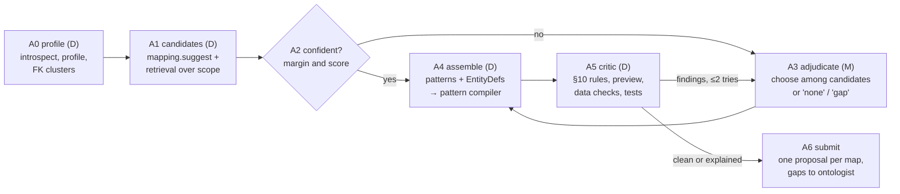

# Mapping Studio and Mapping Authoring Agent: design proposal

| | |
|---|---|
| Status | **Proposed**, 2026-10-28. Not yet in the SysML models; §14 lists the changes. |
| SIP stages | `populate` (author R2RML mappings); `validate` (mapping checks and tests); `model` (impact of ontology edits on maps) |
| New functional elements | `MappingStudio` (the R2RML editor in the workbench) and `MappingAuthoringAgent` (agent `mapping-author`) |
| Builds on | `vkg/` (`r2rml`, `source`, `suggest`, `validate`, `materialise`, `query`), the eleven `mapping.*` operations (AD §6.5), the `agent-mapper` machine role, the agent runtime (`agents/base.py`), and three PoCs: `LAB/PoCs/SPARQL-2-SQL` (declarative `mapping-spec.yaml`, generator, M01–M12 conformance rules), `LAB/PoCs/FIBO-NL2Q-at-Scale` (152-table FIBEN mapping, FIBEN-Obfuscated, 237 gold SPARQL queries) |

**Naming.** This document is about **R2RML** (W3C, relational → RDF). "R2ML" is an
unrelated rule-markup language, so it is not covered.

## Contents

1. [Summary](#1-summary)
2. [Why hand-written R2RML is hard](#2-why-hand-written-r2rml-is-hard)
3. [Users and use cases](#3-users-and-use-cases)
4. [Design principles](#4-design-principles)
5. [Prior art and what we take from it](#5-prior-art-and-what-we-take-from-it)
6. [Information model](#6-information-model)
7. [The mapping pattern catalogue](#7-the-mapping-pattern-catalogue)
8. [Mapping Studio: functional design](#8-mapping-studio-functional-design)
9. [Mapping Authoring Agent](#9-mapping-authoring-agent)
10. [Checks: one critic for people and agents](#10-checks-one-critic-for-people-and-agents)
11. [Interfaces](#11-interfaces)
12. [Security, governance and AI use](#12-security-governance-and-ai-use)
13. [Evaluation](#13-evaluation)
14. [Changes to existing artefacts](#14-changes-to-existing-artefacts)
15. [Delivery plan](#15-delivery-plan)
16. [Decisions and open questions](#16-decisions-and-open-questions)

---

## 1. Summary

R2RML is the contract between a bank's databases and its ontology, and today it is
written by hand in Turtle. That needs someone who knows the schema, the ontology and
R2RML's details at the same time, and who can keep one IRI policy consistent across
hundreds of maps. Very few people know all three. The design removes the need to.

* **Mapping Studio** is an editor in the SIP workbench. People work with
  *correspondences* (this table is a `Customer`, this column is its `hasLegalName`,
  this foreign key is `holdsAccount`) and with **mapping patterns** (subclass table,
  discriminator column, join table, code table). Every edit is previewed against real
  rows and checked immediately. The R2RML is **compiled** from those edits, and nobody
  has to read or type Turtle.
* **The Mapping Authoring Agent** drafts the mapping. It profiles the database, gets
  candidates from the deterministic `mapping.suggest`, and asks the model only where the
  candidates are ambiguous. It then compiles the maps, runs the same checks as the
  editor, and submits **one staged proposal per triples map**, with evidence. A person
  accepts, edits or rejects each one in the Studio's review queue.

Three design choices carry the rest:

1. **R2RML in the `mappings` graph stays the single source of truth.** The Studio is a
   *projection* of it, and every edit is an ordinary `mapping.*` change set with
   history, undo and staging. There is no second, editor-only format that could drift.
2. **Authoring happens at the level of patterns, not triples.** Twelve patterns
   (§7) cover what the SPARQL-2-SQL and FIBEN mappings needed. Each pattern has a
   detector, a form, a compiler and its own checks. The agent and the person pick
   patterns; the compiler writes the R2RML.
3. **The model proposes, deterministic critics decide, a person accepts** (SIP P6). The
   agent can only stage. Ontology gaps it finds become *separate* proposals for the
   ontologist, because changing the ontology is not the mapper's decision.

What is new and what is reused:

| Capability | Reused from SIP today | New in this design |
|---|---|---|
| Source | `mapping.registerDatabase`, `mapping.introspect` (read-only sqlite3 / DuckDB) | `mapping.profile`: row counts, null rates, distinct counts, value patterns, inferred keys and FKs, schema snapshots and drift |
| Suggestions | `mapping.suggest` (lexical + structural, scored, writes nothing) | ontology scoping, candidate retrieval over large ontologies (FIBO), pattern detection, learning from reviewer decisions |
| Authoring | `mapping.addTriplesMap` / `update` / `remove` / `import` | correspondence projection, IRI policy, pattern compiler, `mapping.applyPattern`, YAML spec import/export |
| Checking | `mapping.validate` (15 codes), `mapping.preview` with provenance | merged rule set with the PoC's M01–M12 rules, data checks on samples, quick fixes, mapping tests from competency questions |
| Querying | `mapping.queryData` (in-process), optional Ontop endpoint | test runner over both engines |
| Agent | runtime, budgets, evidence, `agent-mapper` role, `KnowledgeGraphBuilder` (CSV lifting) | `MappingAuthoringAgent` with six modes and an offline simulator |

---

## 2. Why hand-written R2RML is hard

Each item below was hit in this repository's PoCs, and each one becomes a feature
further on.

| # | Difficulty | Where it bit | How the design answers it |
|---|---|---|---|
| H1 | **Two experts are needed.** The data engineer knows `CUST_TYP_CD = 'C'`; the ontologist knows `CorporateCustomer`. Neither knows R2RML. | SPARQL-2-SQL discriminator maps | Correspondence board with both sides visible; patterns hide R2RML (§8.3) |
| H2 | **One IRI policy across every map.** A subclass row and its parent row must be the same IRI, and any map that refers to an entity must reuse its template exactly, or joins silently return nothing. | FIBEN: "every table in a hierarchy mints IRIs from the hierarchy's root table" | IRI policy is a first-class object; templates are never typed (§6.2, §8.4) |
| H3 | **Wrong maps fail silently.** A typo in a template, or a property pointing the wrong way, gives empty answers, not errors. | NL2Q answers that were empty rather than wrong | Every edit shows sample triples from real rows; data checks (§10) |
| H4 | **The foreign key and the property point in opposite directions.** `ACCOUNT.CUST_ID` realises `Customer holdsAccount Account`. | SPARQL-2-SQL "link maps" | Direction-aware link pattern P05; domain/range check M10 |
| H5 | **Datatypes on both sides must agree** with the SQL type and the property's `rdfs:range`. | M09 findings | Datatype chosen from the range; mismatch shown with a fix |
| H6 | **SQL details**: quoted upper-case identifiers, `rr:sqlQuery` views for filters, NULL keys. | M03, M11 | The compiler quotes; filters are form fields; NOT NULL checked |
| H7 | **Scale.** FIBEN has 152 tables, 374 columns and 2,724 lines of R2RML. | `artifacts/ontop/fiben-mapping.r2rml.ttl` | Board with coverage, clustering by FK graph, batch review (§8.3, §9.6) |
| H8 | **Large target ontologies.** FIBO has thousands of classes, and lexical matches are often false friends. | FIBEN↔FIBO `alignment.csv` (`exact` / `suggested` / `none`) | Ontology scoping, ranked retrieval, the model adjudicates only the ambiguous cases (§9) |
| H9 | **Drift.** Schemas change and ontologies are refactored. | `refactor.renameIRI`, `mapping.impact` | Schema snapshots and diff; repair mode of the agent (§9.1) |
| H10 | **"Correct" is judged by the queries the mapping must answer**, not by the Turtle. | NL2Q gold SPARQL | Mapping tests from competency questions and gold queries (§8.7) |

---

## 3. Users and use cases

| Persona | Knows | Needs from SIP |
|---|---|---|
| **Data engineer** | schema, data, SQL | to say what the tables mean without learning OWL or R2RML |
| **Ontologist / mapper** (ST role `mapper`) | the ontology, modelling | to decide the correspondences and the IRI policy, review agent drafts, and see coverage |
| **Reviewer / steward** (holds V) | the domain | to accept or reject staged maps with evidence and a sample of what they produce |
| **NL2Q / consumer engineer** | the queries the business asks | to state the questions the mapping must answer, as tests |

| ID | Use case | Primary persona |
|---|---|---|
| UC-M1 | Connect a database and see what is in it (profile) | data engineer |
| UC-M2 | Bootstrap a first mapping of a whole schema with the agent, then review it | mapper |
| UC-M3 | Map one table by hand with a pattern wizard and live preview | data engineer |
| UC-M4 | Define the IRI policy once and have every map follow it | mapper |
| UC-M5 | Fix check findings with one-click quick fixes | data engineer, mapper |
| UC-M6 | Write mapping tests (competency questions, gold queries) and run them | NL2Q engineer |
| UC-M7 | After a schema change or an ontology refactoring, see the impact and accept repairs | mapper |
| UC-M8 | Import an existing R2RML file (e.g. an Ontop project) and keep editing it in the Studio | mapper |
| UC-M9 | Export R2RML for Ontop, or the YAML spec for code review in git | mapper |

---

## 4. Design principles

| # | Principle | Consequence |
|---|---|---|
| MP1 | **Nobody types Turtle.** | The Studio edits correspondences and pattern parameters; R2RML is compiled. A read-only Turtle view exists for experts and for learning. |
| MP2 | **One source of truth: R2RML in `mappings`.** | The Studio *lifts* maps into patterns when it can. A map no pattern explains is shown as a *custom* map in an expert form and is never dropped (§6.3). |
| MP3 | **Every edit shows data.** | Preview of the logical table rows and of the triples, each with the map that produced it, within 1 s on samples (`mapping.preview`). |
| MP4 | **Checks run continuously and come with fixes.** | The same rule set serves the editor, the agent's critic and the release gate (§10). |
| MP5 | **The model proposes; critics decide; a person accepts.** | The agent runs as a machine principal that can only stage. Proposals carry evidence and critic verdicts (`agents/base.py`). |
| MP6 | **Ontology edits are not mapping edits.** | A missing class or property, or a missing `rdfs:subClassOf`, is a separate proposal to the ontologist (as `mapping.suggest` already does). |
| MP7 | **Correctness is measured by questions.** | Mapping tests are first-class content in the `cq` graph and are part of the release gate. |
| MP8 | **Offline by default.** | Every feature, including the agent, works with the deterministic simulator. Live model runs are opt-in and estimated first. |

---

## 5. Prior art and what we take from it

| System | What it does | What we take | What we leave |
|---|---|---|---|
| **Ontop Protégé plugin** (mapping manager) | Per-map pair "SQL source query → target triples template" with a SQL result preview | Logical-table SQL with a row preview; the map as the unit of review | Writing target templates in a text DSL |
| **Karma** (USC ISI) | Semi-automatic: learns semantic types of columns from user choices, proposes the relationships between them as a Steiner tree over the ontology graph | Learning from the reviewer's accepted and rejected choices; choosing links as a tree over the ontology graph (as NL2Q's grounding does) | Its own model format, export-only R2RML |
| **RMLEditor / Matey / YARRRML** | Graphical or YAML-based authoring of RML | A compact human-readable spec (our `mapping-spec.yaml` plays the role of YARRRML) and a side-by-side data/graph view | Supporting non-relational sources (out of scope: R2RML only) |
| **Juma** | Block-based (Scratch-like) mapping editor that always yields valid mappings | "Valid by construction": forms that cannot express an invalid map | Blocks as the main UI (too slow for 150 tables) |
| **BootOX, Ontop bootstrapper, D2RQ `generate-mapping`** | Direct mapping: one class per table, one property per column | The deterministic first draft, as `vkg_build.py` does for FIBEN | Stopping there: a direct mapping is not a mapping to FIBO |
| **LLM-assisted schema matching** (recent research) | Model ranks or generates correspondences from names, descriptions and samples | The model as an *adjudicator over retrieved candidates*, with a JSON schema | Free-form generation of R2RML Turtle by a model |
| **SIP's own `mapping.suggest`** | Lexical, structural, domain/range-aware proposals | All of it, as stage A1 of the agent and as the Studio's suggestions | — |

---

## 6. Information model

### 6.1 Entities

| Entity | Meaning | Stored in | Class |
|---|---|---|---|
| **Source** | A registered database (read-only), per project | `ctx.databases` (existing) | config |
| **SchemaSnapshot** | Tables, columns, types, PK/FK at a point in time, with a hash | `metadata` graph, `sip:SchemaSnapshot` | content |
| **Profile** | Per-column statistics: rows, null rate, distinct count, top values (if policy allows), value pattern (regex class), inferred key / FK with confidence | derived cache, keyed by snapshot hash | derived |
| **OntologyScope** | The classes and properties the mapping may target (e.g. FIBO modules FBC/PAS, SEC/SEC) | `mappings` graph, `sip:MappingScope` | content |
| **EntityDef** (IRI policy) | One per *identity*: path segment, key column(s) of the root table, template; the tables that share it (a hierarchy) | `mappings` graph, `sip:EntityDef` | content |
| **TriplesMap** | W3C R2RML, as today (skolem IRIs for nested nodes) | `mappings` graph | content |
| **PatternInstance** | Which pattern (§7) a map was compiled from, with its parameters | `mappings` graph, `sip:pattern` / `sip:patternParams` on the map | content |
| **Correspondence** | A *view*: table↔class, column↔property, FK↔relation, with status (mapped / proposed / rejected / ignored) | computed from maps, proposals and decisions | derived |
| **MappingDecision** | A reviewer's "this column is *not* `hasName`" or "ignore this table", with a reason | `mappings` graph, `sip:MappingDecision` | content |
| **MappingTest** | A SPARQL query with an expected result (rows, count, non-empty, or "same answer as gold SQL") | `cq` graph (next to competency questions) | content |
| **Finding** | A check result: rule, severity, map, message, quick fixes | computed | derived |
| **Proposal / Evidence** | A staged change set from the agent with its evidence record | staging graphs, `history` (existing) | workflow |

### 6.2 The IRI policy is an object, not a string

`EntityDef` holds what the PoC's `entities:` block holds:

```turtle
<urn:sip:p:bank:r2rml#entity/customer> a sip:EntityDef ;
    sip:pathSegment "customer" ;
    sip:rootTable   "PUBLIC.CUSTOMER" ;
    sip:keyColumn   "CUST_ID" ;
    sip:template    "https://bank.example/data/customer/{\"CUST_ID\"}" ;
    sip:sharedBy    "PUBLIC.RETAIL_CUSTOMER", "PUBLIC.CORPORATE_CUSTOMER" .
```

Every subject map and every referencing object map is compiled from an `EntityDef`,
never typed. Changing the base IRI or a key is one edit that recompiles every affected
map in one commit. Rule M05 (an IRI used outside its typing table follows a foreign key
to that table's key) and the existing `iri-space-clash` check hold by construction, and
are still checked for imported maps.

### 6.3 Projection: lifting R2RML into patterns

On import and on every change, `studio.lift` matches each triples map against the
pattern compilers in reverse. If compiling the matched pattern with the recovered
parameters reproduces the map *exactly* (graph isomorphism on the map's triples), the
map is shown as that pattern. Otherwise it is a **custom map**, which the expert form
edits field by field. Custom maps are fully supported by checks, preview and tests.

This keeps MP2: the Studio never rewrites a map just because it opened it, and a map
edited by hand outside SIP comes back as custom rather than being "normalised" away.

### 6.4 The YAML spec is an exchange format

`mapping-spec.yaml` from SPARQL-2-SQL becomes `mapping.exportSpec` /
`mapping.importSpec`. It is a reviewable text form for git: entities, maps, filters and
properties, in about a third of the lines of the Turtle. Importing it goes through the
same compiler and checks, so the PoC's file and its generator `build_mappings.py` retire
into SIP.

---

## 7. The mapping pattern catalogue

A pattern is a recurring relational shape with a known R2RML rendering. Each pattern has
a **detector** (what in the schema or profile suggests it), a **form** (the parameters a
person fills in), a **compiler** (parameters → triples maps) and **pattern checks**.

| ID | Pattern | Detector | Compiles to | Pattern checks |
|---|---|---|---|---|
| P01 | **Entity table** | table with a PK | subject from the `EntityDef`, `rr:class`, column POMs | key unique and NOT NULL (M04, M11) |
| P02 | **Subclass table** | PK is also an FK to a parent's PK | same `EntityDef` as the parent, `rr:class` of the subclass | parent class is an ancestor in the ontology, else a separate `subClassOf` proposal |
| P03 | **Discriminator subclass** | low-cardinality text column whose values name classes (`CUST_TYP_CD`) | one `rr:sqlQuery` view per value, each with its class | values cover the column (no unmapped value); classes disjoint if declared so |
| P04 | **Forward link** | FK column on the subject's own table | referencing object map, or template object from the target's `EntityDef` | property domain/range match (M10); FK orphan rate |
| P05 | **Inverse link** | FK stored on the *other* side (`ACCOUNT.CUST_ID` for `Customer holdsAccount Account`) | a class-less map on the FK's table whose subject is the referenced entity | direction agrees with domain/range |
| P06 | **Join table (m:n)** | table whose PK is exactly two FKs and no other data columns | one map: subject = side A, predicate, object = side B | both sides typed elsewhere (M06) |
| P07 | **Associative entity** | join table *with* attributes (`HOLDING`: account, security, quantity) | P01 for the table (an n-ary relation as an entity) + two P04 links | property chain documented for consumers |
| P08 | **Code / lookup table** | small table, a code and a description, referenced by many FKs | individuals (or SKOS concepts) with a stable template on the code; FKs become P04 links to them | every referenced code has a row |
| P09 | **Inline code** | column with a few coded values (`hasType = "1"`) and no lookup table | `rr:sqlQuery` with `CASE` to an IRI or a label, from a value table the person fills in | all observed values mapped; NL2Q value linking sees the labels |
| P10 | **Value transform** | value needs SQL to fit the range: concatenation, unit scaling, date parsing, casting | `rr:sqlQuery` with a named expression column | the expression parses, is read-only, and its type matches the range |
| P11 | **Composite key** | PK of more than one column | template with several placeholders, in key order | all key columns NOT NULL |
| P12 | **Denormalised table** | columns that clearly belong to another entity (`CUSTOMER.BRANCH_NAME`, `BRANCH_CITY`) | a second subject map over the same table, minting the other entity, plus a link | the minted entity's key is functional over the rows |

Out of the catalogue on purpose: entity-attribute-value tables (P13 would need a pivot
per attribute; such tables become custom maps) and named graphs (`rr:graphMap`, which
SIP's R2RML subset does not support yet).

The catalogue is data (`vkg/patterns.py`, one class per pattern), so new patterns can be
added without changing the Studio or the agent.

---

## 8. Mapping Studio: functional design

The Studio is a workbench page (`api/mapping.html`) over `POST /ops/{op}`. It has seven
views, ordered as the work is done.

### 8.1 Connect and profile

Register a database (read-only), then `mapping.profile` shows:

* tables sorted by FK in-degree (the "hubs" first);
* per column: SQL type, null rate, distinct count, a value pattern (`[A-Z]{3}`,
  ISO date, decimal), top values when policy allows (§12);
* inferred keys (unique and not null) and inferred FKs (inclusion dependencies on
  samples) for databases without declared constraints, each marked *inferred* with its
  confidence;
* the FK graph, clustered into communities (customers and accounts, securities and
  markets, filings), which become the work packages of §9.6.

### 8.2 Scope the ontology

FIBO is too large to show in a picker. The mapper chooses the **scope**: modules,
or classes plus their neighbourhood, from the Ontology Repository's module tree.
Suggestions and agent candidates come from the scope only. Terms outside the scope can
still be searched, and using one widens the scope explicitly.

### 8.3 The correspondence board (the main view)

```
┌ Source: core_banking (DuckDB) ─ Scope: FIBO FBC+SEC ─ Coverage: tables 41/152 · cols 210/374 · classes 37 ┐
│ [cluster: Customers & accounts ▾]                       filter: unmapped | proposed | findings           │
├──────────────────────────────┬─────────────────────────────┬────────────────────────────────────────────┤
│ TABLE  CUSTOMER   12,408 rows │ → fibo-fbc-pas-caa:Customer │ P01 Entity  ✓ 0 findings   [preview]       │
│   CUST_ID      int  PK        │   IRI: entity/customer      │                                            │
│   CUST_NM      text 0% null   │ → hasLegalName  (0.91)      │ ✓ accepted                                 │
│   CUST_TYP_CD  text 2 values  │ ⇒ P03 Retail/Corporate      │ ◐ proposed by agent · conf 0.82 [review]   │
│   BRANCH_ID    int  FK        │ → isServicedBy → Branch     │ ⚠ M10 range is Organization  [fix ▾]       │
│   RISK_SCORE   decimal        │   (no property in scope)    │ ✎ ontology gap → proposed to ontologist    │
│ TABLE  ACCOUNT     31,920 rows│ → Account                   │ ...                                        │
└──────────────────────────────┴─────────────────────────────┴────────────────────────────────────────────┘
```

* **Left:** tables and columns with profile badges. **Middle:** the correspondence,
  with confidence when it is a suggestion. **Right:** pattern, status and findings.
* Dragging a column onto a property in the ontology side panel creates the
  correspondence. Choosing a pattern from the row menu opens its form.
* Each row shows its state: *unmapped*, *suggested* (deterministic), *proposed* (agent,
  staged), *accepted*, *ignored* (a `MappingDecision` with a reason), *gap* (proposed to
  the ontologist).
* The coverage bar counts tables, columns and in-scope classes. "Done" is a choice per
  column, not 100% coverage: an ignored column is covered.

### 8.4 Entities and IRI policy

A short wizard, run once per project and editable later:

1. Base IRI (`https://bank.example/data/`).
2. One `EntityDef` per root table, proposed from the PK and the subclass structure
   (P02). The wizard shows which tables share each identity, e.g. "`RETAIL_CUSTOMER`
   and `CORPORATE_CUSTOMER` rows are the same individuals as `CUSTOMER` rows".
3. A preview of three IRIs per entity, from real keys.

Templates are never typed anywhere else in the Studio.

### 8.5 Map editor

Opening a row shows the pattern form, not the Turtle:

* **Form:** pattern parameters, with ontology pickers restricted to compatible terms.
  For example, the property picker for `BRANCH_ID` lists object properties whose domain
  admits the subject class, then the others greyed with the reason.
* **Logical table:** the SQL the pattern generates (read-only for patterns, editable for
  custom maps) and its first 20 rows.
* **Triples preview:** sample triples from `mapping.preview`, with the producing map.
  A changed map shows the triples gained and lost against the committed version.
* **Turtle (read-only):** the compiled R2RML, with each field of the form highlighted
  where it lands. This is how people learn R2RML without having to write it.

### 8.6 Checks and fixes

Findings from §10 appear inline on the board and in a panel. Most come with a **quick
fix** that is itself a change set:

| Finding | Quick fixes offered |
|---|---|
| M10 range mismatch (`isServicedBy` range `Organization`, object is `Branch`) | pick a compatible property · propose `Branch subClassOf Organization` to the ontologist · keep, with a reason |
| M09 datatype mismatch (`DECIMAL` vs `xsd:integer`) | use the range's datatype with a cast (P10) · change `rr:datatype` |
| D2 subject key nulls (3% of rows) | filter `IS NOT NULL` · choose another key |
| P03 unmapped discriminator value `'X'` | map it to a class · ignore it (documented) |
| M12 unused column | map it · ignore it with a reason |

### 8.7 Tests

The mapping is correct when it answers the questions it must answer. A `MappingTest` is:

* a SPARQL query, typed by the scoped ontology;
* an expectation: *non-empty*, an exact *count*, *rows*, or *same answer as this SQL*
  (the last one lets a data engineer state the truth in the language they know);
* optional link to a competency question in the `cq` graph.

`mapping.test` runs the tests on the in-process engine (materialised sample, RDFS
closure) and, when configured, on the Ontop endpoint for full data. NL2Q gold queries
can be imported as tests, which turns the 237 FIBEN gold queries into a regression suite
for the FIBEN mapping.

### 8.8 Review and history

The review queue lists staged maps (from the agent or from people when validation is
on). Each item shows the form view, the diff of triples on the sample, the findings, the
tests affected, and the evidence (§9.5). Actions: **accept**, **edit and accept** (the
edit is recorded as the reviewer's own commit on top), **reject with reason** (becomes a
`MappingDecision`, §9.7). Batch accept is allowed only for proposals with no findings
and confidence over the project's threshold, and is logged as such.

---

## 9. Mapping Authoring Agent

### 9.1 Role and modes

| | |
|---|---|
| Name | `mapping-author` (`MappingAuthoringAgent` in `agents/specialists.py`) |
| Stage | `populate` |
| Principal | machine role `agent-mapper` (existing): `rdf(resource, alignment)` CRUD, `rdf` R. It can stage maps; it can never validate |
| Model tasks | `mapping.adjudicate` (choose among candidates), `mapping.explain` (describe a map for a reviewer) |

| Mode | Trigger | What it does |
|---|---|---|
| **bootstrap** | new source, empty mapping | full pipeline over the scoped schema, cluster by cluster |
| **extend** | new tables or columns in scope | pipeline over the unmapped part only; existing maps are context |
| **repair-drift** | `SchemaSnapshot` diff (renamed, dropped, retyped columns) | proposes updates to the affected maps; a dropped column is a removal proposal, never a silent edit |
| **repair-ontology** | `mapping.impact` after a refactoring (renamed or deleted terms) | proposes new targets for maps with dangling references |
| **fix** | findings or failing tests on a map | proposes a corrected map; at most 2 attempts per finding |
| **explain** | a reviewer opens a proposal | plain-language description of what the map produces, from the compiled map and three sample triples |

### 9.2 Pipeline

The agent is workflow-shaped like the other SIP agents (`plan → propose → criticise →
submit`). Steps marked **D** are deterministic; **M** is the only model step.



* **A0 profile.** `mapping.profile` on the scope; clusters the FK graph so related
  tables are decided together (a customer table and its subtypes, an order and its
  lines).
* **A1 candidates.** `mapping.suggest` supplies scored table→class, column→property and
  FK→relation candidates plus detected patterns. For large ontologies a ranked
  retrieval over the scope's labels, synonyms and definitions adds the top-k (k = 8)
  per element. The NL2Q work showed lexical retrieval alone misses many targets, so
  definitions and FK-neighbour context count too.
* **A2 gate.** A decision goes to the model only if the best candidate's score is
  under 0.85 or its margin over the second is under 0.15. Clear structural decisions
  (P02 subclass tables, P06 join tables) never do. This keeps cost proportional to
  ambiguity, not to schema size.
* **A3 adjudicate.** The model sees one *table card* at a time and must pick, per
  element, one candidate ID, `none`, or `gap` (with a proposed term name). It cannot
  invent an IRI, a template or SQL.
* **A4 assemble.** Chosen correspondences and patterns compile to triples maps under
  the project's `EntityDef`s. If no IRI policy exists, the agent proposes one first, as
  its own proposal: everything else waits for it.
* **A5 critic.** The rule set of §10, a preview on a sample, and any mapping tests that
  touch the map. An error sends the element back to A3 with the finding (at most two
  rounds); a remaining error means the map is not submitted and the board shows it as
  *needs a person*.
* **A6 submit.** One staged proposal per triples map, in dependency order (IRI policy,
  then entities, then links). Gaps go to the ontologist as `owl:Class` /
  property proposals through the ModelingCopilot's path, not into the mapping.

### 9.3 Model contract

Input (one table card):

```json
{"table": "CUSTOMER", "rows": 12408,
 "columns": [{"name": "CUST_TYP_CD", "type": "VARCHAR", "null_rate": 0.0,
              "distinct": 2, "pattern": "[A-Z]", "values": ["R", "C"]}],
 "fks": [{"column": "BRANCH_ID", "references": "BRANCH.BRANCH_ID"}],
 "neighbours": ["ACCOUNT", "BRANCH"], "comments": "…",
 "candidates": {"table": [{"id": "c1", "term": "fibo-fbc-pas-caa:Customer",
                           "label": "customer", "definition": "…", "score": 0.78}],
                "CUST_TYP_CD": [...]},
 "already_mapped": {"BRANCH": "ex-bank:Branch"}}
```

Output (JSON schema enforced):

```json
{"table": {"choice": "c1", "pattern": "P01"},
 "columns": [{"column": "CUST_TYP_CD", "choice": "pattern:P03",
              "values": {"R": "c7", "C": "c8"}},
             {"column": "RISK_SCORE", "choice": "gap",
              "gap": {"kind": "datatypeProperty", "label": "has risk score"}}],
 "rationale": "short, per decision"}
```

A choice that is not a listed candidate ID, `none`, `gap` or a pattern ID is rejected by
the critic before anything is compiled.

### 9.4 Offline simulator

`sim_mapping_author` answers A3 by taking the top candidate when its score is at least
0.5, `none` otherwise, and the detected pattern. With it the whole agent, including the
Studio's review queue, runs in tests and demos with no model. This matches SIP's
offline-by-default rule and gives the baseline the live model must beat (§13).

### 9.5 Evidence on each proposal

The existing evidence record, plus:

* the table card's hash and the profile snapshot hash (not the sample values);
* the candidates considered, with scores, and the chosen one;
* pattern ID and parameters;
* critic verdicts (rules, data checks, tests) and preview counts (triples, subjects);
* model ID, prompt hash, cost; or `simulator`.

### 9.6 Scale

FIBEN-sized schemas (150+ tables) run cluster by cluster. Each cluster is one unit of
work with its own budget and its own review batch, so a reviewer can finish "customers
and accounts" before "filings" exists. Before a live run, the agent reports an estimate:
the number of table cards that pass the A2 gate and the expected tokens. Nothing billed
starts without approval.

### 9.7 Learning from reviewers

A rejection with a reason, or an edit before accepting, is stored as a
`MappingDecision`. Decisions are used in three ways:

1. **Hard constraints:** a rejected correspondence is never proposed again for that
   column, unless the schema changes.
2. **Re-ranking:** accepted correspondences add their column names, value patterns and
   neighbours as features for similar columns (the idea Karma uses for semantic types),
   so the second customer table in a bank gets better candidates than the first.
3. **Few-shot context:** the closest accepted decisions (at most five) go into the
   table card. They are project data, never shared across projects.

---

## 10. Checks: one critic for people and agents

The SIP `mapping.validate` codes and the PoC's M01–M12 rules overlap. They merge into
one catalogue, served by `mapping.validate`, used by the Studio, the agent's A5 and the
release gate.

| Family | Rules | Source |
|---|---|---|
| **Structure (S)** | unknown table / column / placeholder (M01, M02); identifiers quoted (M03); bad or non-read-only SQL; unknown parent map; join required | both |
| **IRI policy (I)** | subject template keyed by a unique key (M04); IRI used outside its typing table follows an FK to that table's key (M05); every template family typed (M06); key columns NOT NULL (M11); IRI-space clash; no-placeholder template | M04–M06, M11 from the PoC; clash from SIP |
| **Ontology (O)** | classes and predicates declared (M07); object vs datatype property (M08); datatype vs range and SQL type (M09); domain / range compatibility (M10); deprecated term | both |
| **Data (D)**, on a sample, new | D1 logical table returns rows; D2 subject key null rate; D3 subjects unique per class map where expected; D4 FK orphan rate of links; D5 typed literal parse rate (a `xsd:date` column with unparsable values); D6 individuals typed with disjoint classes | new |
| **Coverage (C)** | unused tables and columns (M12), in-scope classes with no map, decided-ignore excluded | both |
| **Tests (T)** | failing mapping tests | new |

Severity is *error* (produces wrong or no data), *warning* (probably wrong) or *info*.
The release gate fails on any error and on failing tests marked *required*.

---

## 11. Interfaces

### 11.1 Operations (new and changed)

| Operation | Stage | CRUDV | Capability | What it does |
|---|---|---|---|---|
| `mapping.profile` | populate | R | `rdf` | profile of a source or table; inferred keys and FKs; FK clusters |
| `mapping.snapshot` / `mapping.diffSource` | populate | C / R | `rdf(resource, alignment)` / `rdf` | record a schema snapshot; diff the source against the last one |
| `mapping.setScope` | populate | U | `rdf(resource, alignment)` | ontology scope for suggestions and the agent |
| `mapping.setEntity` / `mapping.removeEntity` | populate | C, U / D | `rdf(resource, alignment)` | IRI policy; recompiles dependent maps in the same commit |
| `mapping.applyPattern` | populate | C, U | `rdf(resource, alignment)` | compile a pattern with parameters to triples maps (one change set) |
| `mapping.lift` | populate | R | `rdf` | pattern view of the current maps (custom where none fits) |
| `mapping.correspondences` | populate | R | `rdf` | the board's rows: correspondences, statuses, coverage |
| `mapping.decide` | populate | C | `rdf(resource, alignment)` | record a `MappingDecision` (ignore, reject with reason) |
| `mapping.addTest` / `mapping.test` | validate | C / R | `rdf(resource, alignment)` / `rdf` | mapping tests in `cq`; run them (in-process or Ontop) |
| `mapping.importSpec` / `mapping.exportSpec` | populate, publish | C / R | as import / export | YAML spec through the same compiler |
| `mapping.validate` | validate | R | `rdf` | merged rule catalogue (§10), with quick fixes |
| `mapping.suggest` | populate | R | `rdf` | gains `scope`, pattern detection P03–P12, decision-aware ranking |

All writes return `ChangeSet`s on `layout.mappings` (or `cq` for tests), so history,
undo and staging apply unchanged.

### 11.2 Agent API

```python
agent = platform.agents["mapping-author"]
run = agent.run("bank", source_id="core_banking", mode="bootstrap",
                clusters=["customers-accounts"], dry_run=True)   # dry_run: estimate only
run.summary()   # proposals, gaps, needs-a-person, cost
```

### 11.3 HTTP

`GET /projects/{p}/mapping` (Studio page), `POST /ops/{op}` for the operations above,
`POST /projects/{p}/agents/mapping-author/runs`, `GET /projects/{p}/review?kind=mapping`.

---

## 12. Security, governance and AI use

* **Authorisation.** Unchanged ST model: the `mapper` role (and ontologist, rdfgeek,
  project manager) edits maps; V holders accept staged ones. `agent-mapper` can only
  stage. Ontology gaps need the ontologist's grant.
* **Databases are read-only.** Sources open read-only; logical tables and test SQL must
  be one `SELECT` (existing guard), run with a timeout and a row cap.
* **What the model may see** is a project policy, `mapping.ai_exposure`:
  * `names` — table and column names, types, FKs and statistics only;
  * `profile` (default) — plus value patterns and distinct counts, no values;
  * `samples` — plus up to five top values per low-cardinality column (needed for
    discriminators and code tables), after masking columns the profile classifies as
    personal data (names, emails, national IDs, account numbers).
  The policy decision is logged with each model call, as for every SIP agent.
* **Billing.** Live runs require `SIP_MODEL` and an approved estimate (§9.6).

---

## 13. Evaluation

The agent and the Studio are evaluated on benchmarks that already exist in this
repository, offline first.

| Benchmark | Source → target | Gold | What it tests |
|---|---|---|---|
| **B1 bank** | SPARQL-2-SQL bank schema → FIBO subset | hand-written `mapping-spec.yaml` (8 entities) | real FIBO targets, discriminators, inverse links |
| **B2 FIBEN** | FIBEN DDL (152 tables) → FIBEN vocabulary | generated `fiben-mapping.r2rml.ttl` | scale, hierarchies; easy lexically |
| **B2-O FIBEN-Obfuscated** | `TBL_C042.ATTR_05` → FIBEN vocabulary | the same gold through `name_map.json` | whether the agent can map from structure and data when names say nothing |
| **B3 FIBEN→FIBO** | FIBEN → FIBO | `alignment.csv` `exact` rows plus a curated sample of `suggested` | the realistic task: a bank schema onto FIBO |

Metrics:

* **Correspondence P / R / F1** for table→class, column→property and FK→relation,
  against the gold, per benchmark.
* **Clean maps:** share of submitted maps with zero errors from §10.
* **Answer equivalence:** gold SPARQL queries answered with the candidate mapping vs the
  gold mapping (the 237 FIBEN gold queries through the NL2Q compile path). This is the
  metric that matters to consumers.
* **Reviewer effort:** decisions a person had to make per accepted map, and the share
  of proposals accepted unedited.
* **Cost:** tokens and model calls per table, and the share of decisions the A2 gate
  sent to the model.

Targets for R2 (§15): on B1 and B2, correspondence F1 ≥ 0.9 with the simulator alone;
on B2-O, the live agent beats the simulator by at least 20 F1 points (names are useless
there, so only profile and structure can help); on B3, recall@1 of FIBO classes ≥ 0.7
on the curated sample, with gaps flagged rather than forced.

---

## 14. Changes to existing artefacts

| Artefact | Change |
|---|---|
| new `vkg/patterns.py` | pattern catalogue P01–P12: detectors, compilers, lift |
| new `vkg/profile.py` | profiling, inferred keys and FKs, FK clustering, schema snapshots and diff |
| `vkg/suggest.py` | scope, pattern detection P03–P12, decision-aware ranking |
| `vkg/validate.py` | merge M04–M06, M10–M12 from `LAB/PoCs/SPARQL-2-SQL/tools/check_mappings.py`; data rules D1–D6; quick fixes |
| new `vkg/spec.py` | YAML spec import/export (retires `build_mappings.py`) |
| new `vkg/tests.py` | mapping tests, both engines |
| `platform.py` | operations of §11.1 |
| `agents/specialists.py`, `agents/simulators.py` | `MappingAuthoringAgent`, `sim_mapping_author` |
| `core/layout.py` | no new graphs: EntityDefs, scope, patterns and decisions live in `mappings`; tests in `cq`; snapshots in `metadata` |
| new `api/mapping.html`, `api/app.py` | Studio page and routes |
| `models/sip_functional.sysml`, `sip_information.sysml`, `sip_requirements.sysml`, `sip_verification.sysml` | `MappingStudio`, `MappingAuthoringAgent`; `EntityDef`, `MappingDecision`, `MappingTest`; FR-VKG-03..07; V-M1..V-M8 |
| `ARCHITECTURE_DESCRIPTION.md` | §6.5 extended; agent table row; scenario "map a new database" |
| `capabilities/CAPABILITY_MAP.md` | SPARQL-2-SQL mapping tools → *absorbed* once R1 lands |
| `generated/` | regenerate with the existing tools, not by hand |

---

## 15. Delivery plan

Each release ends with its verification cases passing offline and the SysML check clean.

| Release | Content | Exit criteria |
|---|---|---|
| **R0: Patterns and checks** | `patterns.py` (P01–P08), `EntityDef`, `applyPattern`, `lift`, merged `validate` with D1–D4, YAML spec import/export | B1 spec imports, lifts with zero custom maps, and re-exports byte-identical R2RML; FIBEN mapping lifts with ≤ 5% custom maps |
| **R1: Studio** | profile, board, IRI wizard, map editor with preview and Turtle view, quick fixes, review queue, tests | UC-M1, M3–M6, M8, M9 demonstrable offline on B1; review of a staged map end to end |
| **R2: Agent offline** | `MappingAuthoringAgent` with the simulator, all modes; P09–P12; D5–D6; evaluation harness on B1, B2, B2-O | simulator targets of §13 on B1 and B2; harness reports all metrics |
| **R3: Agent live** | model adjudication, decision learning, B3 curation | live run on B2-O and B3 **after an approved estimate**; targets of §13 |

---

## 16. Decisions and open questions

### Decisions taken in this proposal

| # | Decision | Alternatives considered | Reason |
|---|---|---|---|
| D1 | R2RML in `mappings` is the only source of truth; the Studio is a projection | Store an editor model and generate R2RML from it | One truth, no drift; imported Ontop files stay editable; history and undo already exist |
| D2 | Authoring through a pattern catalogue | Free-form graphical triples editor; YARRRML text editor | Patterns are valid by construction and are what people and the agent actually reason about |
| D3 | The model only chooses among retrieved candidates | Model writes R2RML or templates directly | Ungrounded IRIs and templates break joins silently (H2, H3); choices are checkable |
| D4 | One staged proposal per triples map | One proposal per run or per table | Reviewable in one screen; partial acceptance is natural |
| D5 | Ontology gaps go to the ontologist as separate proposals | Agent adds terms to the ontology | Separation of duties (MP6); same rule as `mapping.suggest` |
| D6 | Profile-level exposure is the default | Send sample values | Most decisions need patterns, not values; values only where discriminators need them, with masking |
| D7 | Tests are part of the mapping's definition of done | Coverage alone | Coverage says nothing about wrong joins; questions do (H10) |

### Open questions

1. **EAV and other unpatterned shapes.** Is a P13 pivot pattern needed for the target
   banks' schemas, or are custom maps enough?
2. **Named graphs.** Should SIP's R2RML subset add `rr:graphMap` so a map can put its
   triples into a per-source graph (useful for provenance in the KG)?
3. **Ontop at scale for tests.** Running tests against full data needs the Ontop
   sidecar (Docker). Should it be part of the release gate, or advisory?
4. **Decision sharing.** Decisions are per project. Should an organisation be able to
   share an accepted "bank core schema → FIBO" decision set as a starting point for a
   second project?
5. **Code tables.** Individuals or SKOS concepts by default for P08? The proposal
   leaves it to the scope: SKOS if the scope contains a concept scheme for it.
