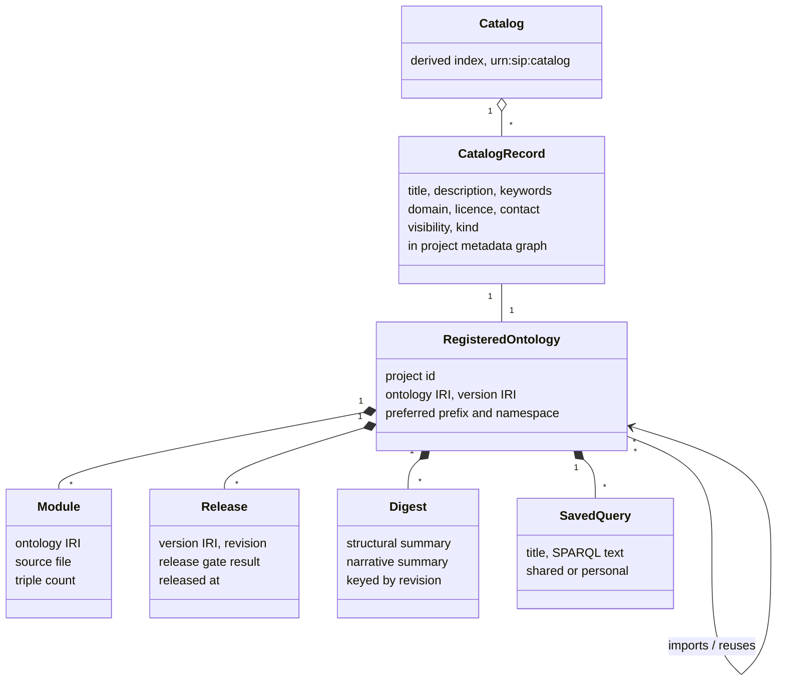
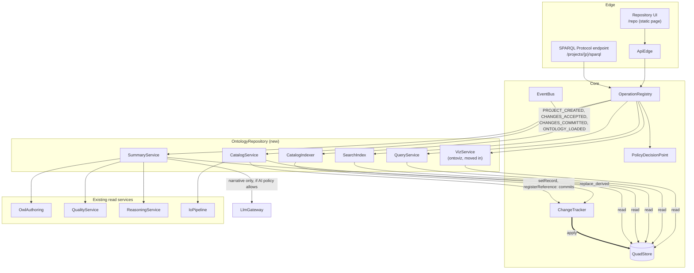
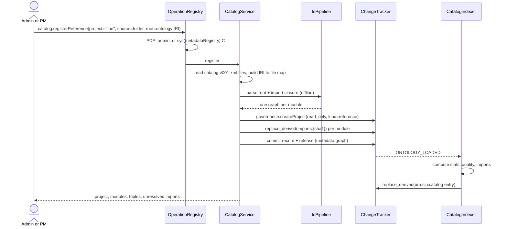

# Ontology Repository: design proposal

| | |
|---|---|
| Status | **Proposed**, 2026-10-20. Not yet in the SysML models; §12 lists the changes. |
| SIP stages | `consume` (browse, summarise, search, query); `publish` (catalog records, releases) |
| New functional element | `OntologyRepository` (catalog, ontology page, summary, search index, guarded SPARQL) |
| Builds on | `browse.*`, `search.searchResource`, `sparql.query`, `browse.metrics`, `quality.*`, `io.export`, `scope` metadata graph, the `viz.*` operations of the visualization PoC (`LAB/PoCs/Ontology-Visualization`), and the Module Digest of the Ontology Assistant design (`capabilities/architecture/ontology_assistant`) |

## Contents

1. [Summary](#1-summary)
2. [Purpose and scope](#2-purpose-and-scope)
3. [Users and use cases](#3-users-and-use-cases)
4. [Prior art and what we take from it](#4-prior-art-and-what-we-take-from-it)
5. [Information model](#5-information-model)
6. [Architecture](#6-architecture)
7. [Functional design](#7-functional-design)
8. [Interfaces](#8-interfaces)
9. [Security and governance](#9-security-and-governance)
10. [Non-functional requirements](#10-non-functional-requirements)
11. [Requirements and verification](#11-requirements-and-verification)
12. [Changes to existing artefacts](#12-changes-to-existing-artefacts)
13. [Delivery plan](#13-delivery-plan)
14. [Decisions and open questions](#14-decisions-and-open-questions)

---

## 1. Summary

The Ontology Repository is the front door to every ontology SIP holds. A **catalog** lists
the registered ontologies, with facets, quality badges and a dependency map. Opening one
gives its **ontology page**: a summary, a browsable and visual view, search, and a SPARQL
workbench, plus versions, quality and downloads.

Three design choices carry the rest:

1. **A registered ontology is a SIP project.** Ontologies built in SIP are *managed*
   projects. External ones such as FIBO are *reference* projects: loaded from a source,
   read-only (`ProjectConfig.read_only`), and refreshed only by re-registration. Nothing
   bypasses `Platform.call`, the PDP or the named-graph layout.
2. **The catalog record is RDF in the project's `metadata` graph**, edited through commits
   like every other content. The platform-level catalog is a **derived, recomputable index**
   built from those records and computed statistics, refreshed by platform events.
3. **The repository reads; it never writes content.** Every repository operation is `R`
   except editing the catalog record and registering a reference ontology. SPARQL is
   query-only, dataset-isolated, time-boxed and row-capped.

What is new and what is reused:

| Capability | Reused from SIP today | New in this design |
|---|---|---|
| Catalog | project registry, `metadata` graph, ST `sys(metadataRegistry)` capability, `ProjectACL` | `catalog.*` operations, catalog record vocabulary, visibility levels, derived catalog index, dependency map |
| Summary | `browse.metrics`, `quality.runChecks`, `quality.releaseGate`, `quality.runCompetencyQuestions`, `quality.verbaliseAxioms`, `LlmGateway` | structural summary, grounded narrative summary cached per revision |
| Visualize | `viz.neighbourhood`, `viz.search`, `viz.stats`, `viz.exportSVG` (PoC) | module graph, catalog dependency graph, move of `ontoviz` into `sip/` |
| Search | `search.searchResource` | per-revision search index, ranking, facets, cross-catalog search |
| SPARQL | `sparql.query` | dataset selector, guard rules, limits, examples from CQs, saved queries, SPARQL 1.1 Protocol endpoint |
| Reference ontologies | `io.loadRDF` with `as_import`, `imports:{sha1}` graphs | `catalog.registerReference` with XML-catalog resolution (FIBO's `catalog-v001.xml`) |

---

## 2. Purpose and scope

**Purpose.** Let anyone with access find an ontology, understand what it covers in a few
minutes, inspect its structure, find the terms they need, and query it, without installing
Protégé or reading Turtle.

### In scope

* A catalog of all registered ontologies, filtered to what the viewer may see.
* An ontology page per registered ontology, with seven tabs (§7.2).
* Structural summaries (deterministic) and narrative summaries (LLM, optional, grounded).
* Visualization of hierarchy, neighbourhood, modules and inter-ontology dependencies.
* Search inside one ontology and across the catalog.
* Read-only SPARQL over a chosen dataset of the ontology's graphs.
* Registration of reference ontologies from files, a folder with an XML catalog, or a URL.
* Versions: the release list and a diff between two releases.

### Out of scope

* Editing ontology content. The page links to the workbench (`/ui`) for members who can
  edit; the repository itself stays read-only.
* SPARQL Update. It stays a separate operation (`sparql.update`) with its own capability.
* Federated queries to external endpoints (`SERVICE`).
* Mappings between ontologies as a browsable product (OntoPortal-style). The `mappings`
  graph is shown on the page, but cross-catalog mapping curation is a later release (§13).
* The conversational Ontology Assistant. It consumes the repository's summaries and search;
  it is designed separately.

---

## 3. Users and use cases

| Stakeholder | What they need from the repository |
|---|---|
| Knowledge engineer / ontologist | Find reusable ontologies and terms before modelling; check what imports what |
| Data architect | Understand coverage and quality before mapping a database to an ontology (VKG) |
| Application / NL2Q developer | Find classes and properties, test SPARQL, copy prefixes and example queries |
| Business analyst / SME | Read a plain-language summary; search terms in their own words |
| Project manager / governance | See status, owner, licence, release and quality gate per ontology |
| Agents (Assistant, Requirements, Modeler) | Call the same operations as tools: catalog search, term search, summary, SPARQL |

| ID | Use case | Main operations |
|---|---|---|
| UC-R1 | Browse the catalog, filter by domain and status, open an ontology | `catalog.list`, `catalog.facets` |
| UC-R2 | Find which ontology defines a term ("legal entity") across the catalog | `catalog.search` |
| UC-R3 | Read a one-page summary of an ontology | `repo.card`, `repo.summary` |
| UC-R4 | Explore the class hierarchy and a concept's neighbourhood visually | `browse.classTree`, `viz.neighbourhood` |
| UC-R5 | See how an ontology's modules and imports fit together | `repo.modules`, `viz.moduleGraph` |
| UC-R6 | Run a SPARQL query, starting from an example, and download results | `sparql.examples`, `sparql.query` |
| UC-R7 | Compare two releases | `repo.versions`, `repo.diff` |
| UC-R8 | Register an external ontology (FIBO) as a reference ontology | `catalog.registerReference` |
| UC-R9 | Edit the catalog record (title, description, keywords, licence, contact) | `catalog.setRecord` |

---

## 4. Prior art and what we take from it

These public ontology repositories set the feature baseline. The design takes one idea from
each and adds what none of them has: governance, review-gate status and quality evidence in
the same place.

| Tool | Idea adopted here |
|---|---|
| **OntoPortal** (BioPortal, AgroPortal) | Catalog with metadata, metrics per ontology, search across ontologies, a SPARQL endpoint, and per-ontology pages with tabs |
| **EBI Ontology Lookup Service (OLS)** | Search-first entry: one box, ranked hits across ontologies, then term pages with trees |
| **Linked Open Vocabularies (LOV)** | Dependency map between vocabularies (who reuses whom) and reuse counts as a signal of quality |
| **VocBench 3 / Semantic Turkey** | Metadata registry with DCAT/VoID records and the `sys(metadataRegistry)` capability; project list filtered by bindings |
| **Widoco, pyLODE** | Generated documentation: overview, namespaces, class and property sections, rendered from annotations |
| **WebVOWL** | Visual overview; the PoC research showed whole-ontology graphs do not scale, so we keep search-first ego views (see the research report) |

What SIP adds that none of these offer together: the release-gate result, ICV findings and
CQ coverage on the catalog card; staged-change overlays for reviewers; and every read
running through the same PDP as editing.

---

## 5. Information model

### 5.1 Entities



| Entity | Meaning | Where it lives | Written by |
|---|---|---|---|
| RegisteredOntology | One SIP project and the ontology in its `main` graph (+ imports) | project registry + `main` | `governance.createProject`, `catalog.registerReference` |
| CatalogRecord | Descriptive metadata for the catalog | project `metadata` graph, node `urn:sip:p:{p}:record` | `catalog.setRecord` (commit) |
| Module | One ontology document in the import closure (FIBO has ~290) | derived from `main` + `imports:{sha1}` graphs | computed |
| Release | A published version (version IRI + revision) | project `metadata` graph | the publish stage (release gate) |
| Digest | Structural and narrative summary for one revision | new derived graph `urn:sip:p:{p}:digest` | `repo.summary` (derived, recomputable) |
| SavedQuery | A named SPARQL query | shared: `metadata` graph (commit); personal: settings scope `pu` | `sparql.saveQuery` |
| Catalog | The platform-wide index of records + computed stats | new derived graph `urn:sip:catalog` | `CatalogIndexer` on events |

**Kinds of registered ontology.**

* `managed`: built in SIP; content changes through the lifecycle.
* `reference`: loaded from an external source (FIBO, PROV-O, SKOS, Schema.org); the
  project is `read_only`; a new version is a re-registration that creates a new release.

**Visibility levels** (new field on `ProjectConfig`, default `private`):

| Level | Catalog record | Content (page, search, SPARQL) |
|---|---|---|
| `private` | members only | members only |
| `listed` | every authenticated user | members only; others see a "request access" action |
| `open` | every authenticated user | every authenticated user, with an implicit `visitor` binding |

Reference ontologies with an open licence (FIBO is MIT-licensed) default to `open`.

### 5.2 RDF representation

The record uses established vocabularies so it can be exported as DCAT and later aligned
with MOD, the metadata vocabulary OntoPortal uses. SIP-specific fields use the `sip:`
namespace already in `core/namespaces.py`.

```turtle
<urn:sip:p:fibo:record> a dcat:Dataset, sip:CatalogRecord ;
    dcterms:title        "Financial Industry Business Ontology"@en ;
    dcterms:description  "Formal model of financial instruments, parties, contracts ..."@en ;
    dcat:keyword         "finance"@en, "securities"@en, "legal entities"@en ;
    dcat:theme           <urn:sip:domain:finance> ;
    dcterms:license      <https://opensource.org/licenses/MIT> ;
    dcat:contactPoint    [ a vcard:Kind ; vcard:fn "EDM Council FIBO team" ] ;
    foaf:primaryTopic    <https://spec.edmcouncil.org/fibo/ontology/> ;
    owl:versionIRI       <https://spec.edmcouncil.org/fibo/ontology/master/2026Q3/> ;
    vann:preferredNamespacePrefix "fibo" ;
    adms:status          <urn:sip:status:released> ;
    sip:kind             sip:Reference ;
    sip:visibility       sip:Open ;
    sip:source           <file:Ontology%20Repository/FIBO/fibo/catalog-v001.xml> ;
    sip:lifecycleStage   "consume" .
```

Computed values (counts, quality, last change) are **not** stored in the record. They are
recomputed into the derived catalog index, so the record holds only what a person decides.

### 5.3 Catalog index entry (derived)

One entry per registered ontology, rebuilt on events; it is what `catalog.list` returns.

```json
{
  "project": "fibo",
  "kind": "reference",
  "visibility": "open",
  "title": "Financial Industry Business Ontology",
  "description": "Formal model of financial instruments, parties, contracts ...",
  "ontology_iri": "https://spec.edmcouncil.org/fibo/ontology/",
  "version_iri": "https://spec.edmcouncil.org/fibo/ontology/master/2026Q3/",
  "keywords": ["finance", "securities", "legal entities"],
  "domain": "finance",
  "licence": "MIT",
  "status": "released",
  "stats": {"modules": 290, "triples": 131893, "classes": 3081,
            "object_properties": null, "data_properties": null, "individuals": null},
  "quality": {"release_gate": null, "findings": null, "findings_age": null,
              "cq_pass": null, "label_coverage": null},
  "imports": ["https://www.omg.org/spec/Commons/..."],
  "imported_by": [],
  "updated_at": "2026-10-20T09:00:00Z",
  "revision": 12,
  "access": "read"
}
```

The FIBO figures for modules, triples and classes are the measured values from
`tests/test_corpus_fibo.py` (290 files, 131,893 triples) and the visualization PoC (3,081
classes). The `null` values have not been computed yet; `null` is also what the index
returns until a check has run, so the card can say "not run" instead of showing a
misleading zero. `access` is computed per viewer (`read`, `request`, `edit`).

---

## 6. Architecture

### 6.1 Placement in the functional view



Both structural guarantees of the AD (§6.2) still hold:

1. **Only the tracker writes.** Record edits and reference registration are commits; the
   catalog index and digests are written with `replace_derived`, which already lives in
   `core/changes.py`.
2. **Agents reach the repository only through guarded operations.** The Assistant uses
   `catalog.search`, `repo.summary` and `sparql.query` as tools through `Platform.call`.

### 6.2 Components

| Component | Responsibility | Proposed module |
|---|---|---|
| CatalogService | List, facet and filter records by viewer; register reference ontologies; edit records | `repository/catalog.py` |
| CatalogIndexer | Subscribe to events; recompute an index entry (stats, quality, imports) for the affected project; debounce | `repository/indexer.py` |
| SummaryService | Structural summary from metrics, hierarchy, ICV, CQs; narrative summary through `LlmGateway` with a grounding critic; cache per revision | `repository/summary.py` |
| SearchIndex | Per-revision inverted index over labels, synonyms, definitions and local names; ranking; facets; cross-catalog query | `search/index.py` (extends `search/`) |
| QueryService | SPARQL guard, dataset assembly, limits, timeouts, result formats; examples; saved queries | `repository/query.py` |
| VizService | The PoC's `index.py`, `neighbourhood.py`, `overlays.py`, `contract.py`, `svg.py`, plus the module graph | `viz/` (Phase 1 of the PoC plan) |
| Repository UI | Catalog and ontology pages; one static page with vendored Cytoscape.js, like the workbench | `api/repository.html` |

### 6.3 Registering a reference ontology (UC-R8)

FIBO ships as about 290 RDF/XML files with `catalog-v001.xml` files that map ontology IRIs to
local files. Registration resolves imports through those catalogs, never over the network.



Unresolved imports (an IRI with no catalog entry and no file) are reported, not fetched. The
PM can add them as further reference ontologies or accept the gap.

### 6.4 Keeping the catalog current

The indexer is event-driven and incremental: an event names the project, so only that entry
is recomputed. Heavy parts (classification, ICV over FIBO) are **not** run by the indexer.
It reads the last results (`ctx.reasoner.last`, the last ICV run, the last release gate) and
shows their age on the card. A nightly job can refresh them.

| Event | Recomputed |
|---|---|
| `PROJECT_CREATED`, `ONTOLOGY_LOADED` | the whole entry |
| `CHANGES_COMMITTED`, `CHANGES_ACCEPTED`, `CHANGES_UNDONE` on `main` | stats, imports, `updated_at`, `revision`; marks the digest stale |
| commit on `metadata` | record fields |
| `ONTOLOGY_CLASSIFIED` | quality block (unsatisfiable count) |
| release gate run | quality block, `status` |

Staged changes do not change the catalog. The catalog shows the stable view, because it is
what non-members and consumers rely on.

---

## 7. Functional design

### 7.1 Catalog

**Layout.** A search box across the top; facets on the left; result cards on the right; a
toggle between cards, a table and the dependency map. The wireframe's values are
illustrative; `bank-core` is a hypothetical managed project.

```
+--------------------------------------------------------------------------------+
|  Ontology Repository                         [ Search terms or ontologies... ] |
+-------------------+------------------------------------------------------------+
| Domain            |  12 ontologies                 Sort: [Recently updated v]  |
|  [x] finance (4)  |  View: (o) Cards  ( ) Table  ( ) Dependency map            |
|  [ ] insurance(2) | +--------------------------------------------------------+ |
| Kind              | | FIBO  Financial Industry Business Ontology  REFERENCE  | |
|  [ ] managed      | | Formal model of financial instruments, parties ...     | |
|  [ ] reference    | | 290 modules . 3,081 classes . MIT . v2026Q3            | |
| Status            | | Gate: PASS . Findings: 0 errors . Updated 20 Oct       | |
|  [ ] in review    | | [Open] [SPARQL] [Download v]                           | |
|  [ ] released     | +--------------------------------------------------------+ |
| Licence           | | bank-core  Retail banking core   MANAGED  IN REVIEW    | |
| Language          | | Accounts, customers, products for the NL2Q pilot ...   | |
| Access            | | 48 classes . 3 staged changes . CQs 11/14 pass         | |
|  [ ] can edit     | | imports FIBO-FND, FIBO-BE                               | |
|  [ ] can read     | | [Open] [SPARQL] [Workbench]                            | |
+-------------------+------------------------------------------------------------+
```

**Card fields.** Title, short name, kind and status chips; two lines of description; size
(modules, classes, properties); licence and version; release-gate result; error count;
CQ pass rate if CQs exist; last update; the viewer's access; actions by access (Open,
SPARQL, Download, Workbench for editors, Request access for `listed`).

**Facets.** Domain (`dcat:theme`), kind, status (lifecycle stage and `adms:status`),
licence, language (from label language tags), model type (OWL, SKOS), and access. Counts
are computed over the entries the viewer can see.

**Sort.** Recently updated (default), name, size, most reused (imported-by count, the LOV
signal).

**Dependency map.** A graph of registered ontologies, with an edge for `owl:imports` and a
dashed edge for declared reuse (`scope` reuse candidates). Node size is class count; colour
is kind. Clicking a node opens its page. With tens of ontologies this fits on one screen, so
it uses the dagre layout without a cap; above 150 nodes it switches to an ego view.

**Cross-catalog search** (UC-R2). The box searches both ontology records and terms. Results
come in two groups: ontologies (title, keywords, description) and terms (label, ontology,
type, definition snippet). Terms that several ontologies define appear once with each
ontology listed, which answers "who defines Party?" directly.

### 7.2 Ontology page

```
+--------------------------------------------------------------------------------+
| < Catalog   FIBO  Financial Industry Business Ontology   REFERENCE . RELEASED   |
| https://spec.edmcouncil.org/fibo/ontology/   v2026Q3   MIT   prefix fibo       |
| [Overview] [Browse] [Visualize] [Search] [SPARQL] [Versions] [Quality] [Download]|
+--------------------------------------------------------------------------------+
| Overview                                                                       |
|  What it covers          (narrative summary, every sentence cites terms)       |
|  At a glance             290 modules  3,081 classes  DL hint  label coverage   |
|  Main concepts           top classes by descendants, with one-line glosses     |
|  Key relationships       most used object properties, domain -> range          |
|  Modules                 FND 41 . BE 36 . FBC 28 . SEC 45 ... (tree)           |
|  Depends on / used by    OMG Commons . LCC  |  bank-core                       |
|  Questions it can answer competency questions, with pass/fail if tests exist   |
|  Known gaps              unresolved imports, unlabelled classes, open findings |
+--------------------------------------------------------------------------------+
```

| Tab | Content | Operations |
|---|---|---|
| Overview | Structural and narrative summary (§7.3) | `repo.card`, `repo.summary` |
| Browse | Class, property and concept-scheme trees; resource view of the selected entity (frame, usage, Manchester rendering) | `browse.classTree`, `browse.propertyTree`, `skos.topConcepts`, `browse.resourceView`, `browse.usage` |
| Visualize | Ego graph, module graph, hierarchy (§7.4) | `viz.*` |
| Search | In-ontology search with facets (§7.5) | `repo.search` |
| SPARQL | Query workbench (§7.6) | `sparql.query`, `sparql.examples`, saved queries |
| Versions | Releases, the change history summary, diff between two releases | `repo.versions`, `repo.diff`, `history.list` |
| Quality | Metrics tables, ICV findings, release-gate checks, CQ results | `browse.metrics`, `quality.runChecks`, `quality.releaseGate`, `quality.runCompetencyQuestions` |
| Download | Turtle, RDF/XML, JSON-LD, N-Triples; with or without imports and inferred triples; the record as DCAT | `io.export`, `catalog.exportRecord` |

Every entity in every tab is a link to the same resource view, keyed by IRI, so a deep link
`/repo/fibo?term=<IRI>` opens the Browse tab on that term.

Members with `V` capability see a "Show staged changes" switch on Browse and Visualize, which
uses the PoC's staged overlay. Everyone else sees the stable view only.

### 7.3 Summarize

Two layers, so the page is useful without any language model.

**Structural summary (deterministic, always available).** Computed from existing services
and cached per revision.

| Section | Source |
|---|---|
| Identity: IRI, version IRI, prefix, licence, creators | `main` ontology header + record |
| Size: modules, triples, classes, properties, individuals, axioms by type | `browse.metrics` |
| Expressivity hint | `metrics.expressivity` |
| Main concepts: top 10 classes by descendant count, plus by in-degree | `owl/hierarchy.py`, viz index |
| Key relationships: object properties by usage, with domain and range | `browse.usage`, property frames |
| Modules: tree by IRI path, with per-module class counts | import closure (§5.1) |
| Annotation coverage: share of entities with a label, a definition (`skos:definition`, `rdfs:comment`, FIBO's definition annotations), label languages | annotation scan |
| Quality: findings by severity, release gate result, unsatisfiable classes, age of each result | `quality.*`, `reasoning.status` |
| Competency questions: list with pass/fail | `quality.runCompetencyQuestions` |
| Known gaps: unresolved imports, unlabelled classes, deprecated-but-used terms | indexer + ICV |

**Narrative summary (optional, through `LlmGateway`).** The structural summary plus
verbalised definitions of the top classes (`quality.verbaliseAxioms`) are the only input.
The output follows the Ontology Assistant's Module Digest so the Assistant can reuse it:

```
Digest
  revision, generated_at, generator (simulator | model id), prompt_hash
  purpose            3 sentences in plain business English
  top_classes[]      {iri, gloss}            gloss from the definition, shortened
  key_properties[]   {iri, gloss}
  example_questions[]  5 questions the ontology can answer (from CQs first)
  example_queries[]    3 SPARQL queries, each executed and kept only if it returns rows
  known_gaps[]       from the structural summary
  citations          sentence -> [IRIs]
```

Grounding rules, enforced by a critic before the digest is stored:

1. Every sentence of `purpose` cites at least one IRI, and every cited IRI exists in the
   ontology.
2. Any quoted label matches an `rdfs:label` or `skos:prefLabel` exactly.
3. Example queries are executed against the stable view with the guard of §7.6; queries that
   fail or return nothing are dropped. This is the execution-filtered example idea from the
   NL2Q research (SPARQL-LLM, TEXT2SPARQL 2026).
4. The digest is marked `ai_generated` with model id and prompt hash, like agent evidence,
   and the page labels it "AI-generated summary, checked against the ontology".

**Policy.** The narrative summary runs only if the project's `AiPolicy.llm_allowed` is true.
In the default offline mode the simulator produces a template-based narrative from the
structural summary, so tests and demos stay deterministic. A live model is opt-in
(`SIP_MODEL`), as everywhere in SIP.

**Caching.** Digests are stored in `urn:sip:p:{p}:digest`, keyed by revision. A commit on
`main` marks the digest stale; the page shows the stale digest with its revision until a
refresh. Reference ontologies change only on re-registration, so their digest is computed
once per release.

### 7.4 Visualize

The views follow the visualization research and PoC: search-first, capped, expandable on
demand, with the class tree as the baseline view.

| View | What it shows | Basis | Limits |
|---|---|---|---|
| Neighbourhood (ego) | A seed class and its typed edges (subclass, restriction, object property, disjointness, SKOS broader), expanded by degree of interest | `viz.neighbourhood` (PoC) | cap 40 by default, at most 300 (dagre took 1.4 s at 300 nodes in the PoC); hub guard asks before expanding hubs |
| Hierarchy | Indented class tree with counts; optional inferred superclasses | `browse.classTree`, reasoner | lazy loading by level |
| Module graph | Modules of one ontology and their imports, sized by class count | new `viz.moduleGraph` | FIBO ~290 modules: grouped by domain (FND, BE, FBC, SEC ...) and expanded per group |
| Dependency map | Ontologies in the catalog and their imports and reuse | new `viz.catalogGraph` | ego view above 150 nodes |
| Static export | Deterministic layered SVG of any of the above, for reports and release notes | `viz.exportSVG` | no cairo, no Graphviz |

Overlays from the PoC stay available: inferred edges, unsatisfiable classes, quality
findings, CQ coverage, and (for reviewers) staged changes. Restrictions are tagged edges;
`min 0` restrictions (17% of FIBO's restriction edges) form their own edge kind, hidden by
default. A table view of the visible nodes and edges sits under every graph, for
accessibility and for copying.

### 7.5 Search

**In one ontology.** One box with live results; facets for entity type (class, object
property, data property, individual, concept), module, deprecated, and language.

**Across the catalog.** The same index queried over every ontology the viewer can read,
grouped by term (§7.1).

**Ranking.** Exact label match, then label prefix, then synonym (`skos:altLabel`, FIBO
synonyms), then local name, then a word in the definition. Within a rank, prefer
non-deprecated terms and terms with more usages. Matching is case- and accent-insensitive,
with simple plural folding. Fuzzy matching (the existing `fuzzy` mode) is a fallback when
nothing else matches.

**Index.** `search.searchResource` scans the graph on every call, which is fine for small
projects. For FIBO-sized ontologies the design adds a per-revision inverted index, built
like the PoC's viz index (0.7 s to index FIBO's 3,081 classes) and cached by
`(project, revision, view)`. The index is shared by the Search tab, cross-catalog search,
`viz.search` and the Assistant.

Each hit returns IRI, preferred label, matched field and text, type, module, and a definition
snippet, so the result list explains why each hit matched.

### 7.6 SPARQL

```
+--------------------------------------------------------------------------------+
| Dataset: [x] ontology  [x] imports  [ ] inferred  [ ] KG  [ ] CQs  [ ] metadata  |
|          View: (o) stable  ( ) staged (members only)     Limit [1000]  Timeout 10s|
+------------------------------------------+-------------------------------------+
| PREFIX fibo-fnd-org: <...>   (auto)      | Examples                            |
| SELECT ?org ?label WHERE {               |  . All classes in a module          |
|   ?org rdfs:subClassOf* fibo-be:LegalE.. |  . Subclasses of a class            |
|   ?org rdfs:label ?label }               |  . Properties with domain X         |
| LIMIT 100                                |  . CQ-07 Which entities own ...     |
|                       [Run  Ctrl+Enter]  | Saved queries                       |
+------------------------------------------+  . my: unlabelled classes           |
| 37 rows . 84 ms . stable rev 12          |  . shared: module sizes             |
| org                         | label      |                                     |
| fibo-be-le-lp:LegalPerson   | legal pers.| [Table] [Graph] [JSON] [CSV] [TTL]  |
+------------------------------------------+-------------------------------------+
```

**Editor.** Syntax highlighting and completion of prefixes and terms from the search index
(the same completion idea as `owl.complete`). Prefixes declared in the ontology are added
automatically and shown folded.

**Dataset selector.** Each checkbox adds named graphs to the query's dataset. The default
graph is the union of the selected graphs, and each is also available by name for
`GRAPH` patterns, so queries such as "which module defines X" work. The staged view is
offered only to project members.

| Checkbox | Graphs |
|---|---|
| ontology | `main` |
| imports | `imports:{sha1}` for the closure |
| inferred | `inferred` (absent until classification has run; the box says so) |
| KG | `kg` |
| CQs | `cq` |
| metadata | `metadata` (record, specification, releases) |
| mapped data | the VKG through `mapping.queryData`, as a separate mode, because it queries the mapped database, not the store |

**Examples.** `sparql.examples` returns three kinds:

1. Template queries filled with the ontology's own terms (classes in a module, subclasses of
   a top class, properties with a given domain, unlabelled entities, deprecated terms).
2. The project's competency questions with their SPARQL tests from the `cq` graph.
3. The digest's execution-checked example queries (§7.3).

**Results.** SELECT as a table (IRIs shown as labels with the IRI on hover, each linking to
the Browse tab); CONSTRUCT and DESCRIBE as a small graph in the Visualize renderer, capped
like the ego view; ASK as a single result. Downloads in SPARQL JSON, CSV, TSV and Turtle.

**Saved queries.** Personal queries live in the project-user settings scope (`pu`), which
Semantic Turkey's settings model already has. Shared queries are commits to the `metadata`
graph (`sip:SavedQuery` with title, description, text, author), so they have history and
need the record's write capability.

**SPARQL 1.1 Protocol endpoint.** `GET|POST /projects/{p}/sparql` accepts standard
`query=` requests and content negotiation, so tools such as YASGUI, Protégé's SPARQL tab,
rdflib or pandas can query a registered ontology directly. It calls `sparql.query` through
`Platform.call`, so it has the same guard and authorisation.

**Guard.** Specified in §9.2.

---

## 8. Interfaces

### 8.1 Operations

All operations are registered with `@operation`, appear in `GET /operations`, and run
through `Platform.call`. Platform-level operations take `project=None` (§12 lists the PDP
change this needs).

| Operation | Scope | Capability | CRUDV | Stage | Returns |
|---|---|---|---|---|---|
| `catalog.list(filters, sort, page, size)` | platform | `sys(metadataRegistry)` | R | consume | index entries visible to the caller, facet counts, total |
| `catalog.facets(filters)` | platform | `sys(metadataRegistry)` | R | consume | facet values with counts |
| `catalog.search(text, kinds, ontologies, limit)` | platform | `sys(metadataRegistry)` | R | consume | ontology hits; term hits grouped by IRI, only from readable projects |
| `catalog.dependencyGraph()` | platform | `sys(metadataRegistry)` | R | consume | nodes and edges between visible ontologies |
| `catalog.registerReference(project, source, root, title, visibility)` | platform | `admin` or `sys(metadataRegistry)` C | C | acquire | project, modules, triples, unresolved imports |
| `catalog.refreshReference(project, source)` | project | `pm(project)` | U | acquire | new release, diff summary |
| `catalog.setRecord(fields)` | project | `rdf(ontology, metadata)` | U | publish | commit |
| `catalog.exportRecord(format)` | project | `rdf` | R | publish | DCAT record in Turtle or JSON-LD |
| `repo.card()` | project | `rdf` | R | consume | index entry + record + viewer access |
| `repo.summary(level, refresh)` | project | `rdf` (`refresh` with `narrative` needs `rdf` U and AI policy) | R | consume | structural summary; narrative digest if requested |
| `repo.modules()` | project | `rdf` | R | consume | module tree with sizes and imports |
| `repo.versions()` | project | `rdf` | R | consume | releases with version IRI, revision, gate result |
| `repo.diff(from_version, to_version)` | project | `rdf` | R | consume | added, removed and changed entities; axiom counts |
| `repo.search(text, types, modules, langs, limit)` | project | `rdf(resource)` | R | consume | ranked hits with matched field |
| `sparql.query(query, dataset, view, limit, timeout_ms)` | project | `rdf(sparql, core)` | R | consume | rows / graph / boolean, with `truncated`, `elapsed_ms`, `revision` (extends the existing operation; current arguments keep working) |
| `sparql.examples()` | project | `rdf` | R | consume | template, CQ and digest examples |
| `sparql.saveQuery(title, query, shared)` | project | personal: `rdf` R; shared: `rdf(ontology, metadata)` C | C | consume | id (commit when shared) |
| `sparql.listQueries()` / `sparql.deleteQuery(id)` | project | as above | R / D | consume | saved queries |
| `viz.neighbourhood`, `viz.search`, `viz.individuals`, `viz.stats`, `viz.exportSVG` | project | `rdf` | R | consume | as in the PoC |
| `viz.moduleGraph(group_by)` | project | `rdf` | R | consume | module nodes and import edges, Playground-superset JSON |
| `viz.catalogGraph()` | platform | `sys(metadataRegistry)` | R | consume | as `catalog.dependencyGraph`, in viz JSON |

`visitor`, the weakest of Semantic Turkey's nine roles, already holds `rdf` R and
`sys(metadataRegistry)` R, so a visitor binding is exactly "may browse and query". No new
role is needed.

### 8.2 HTTP routes

The generic route `POST /projects/{p}/ops/{op}` serves every project operation unchanged.
The design adds:

| Route | Purpose |
|---|---|
| `GET /repo` | Repository UI (static page; no server logic of its own, like `/ui`) |
| `POST /ops/{op}` | Platform-level operations (`catalog.*`, `viz.catalogGraph`) with `project=None` |
| `GET\|POST /projects/{p}/sparql` | SPARQL 1.1 Protocol, read-only |
| `GET /ontologies/{p}` | Content negotiation: HTML redirects to the page; Turtle, RDF/XML and JSON-LD return `io.export` of the stable release |

`/health` currently lists every project name to any caller. It should return only counts,
because names of `private` projects are themselves information (§9).

---

## 9. Security and governance

### 9.1 Visibility and authorisation

* `catalog.list`, `catalog.search` and `catalog.dependencyGraph` filter **inside the
  operation** with the PDP, per entry: `private` entries appear only for principals with a
  binding; `listed` and `open` entries for every authenticated principal.
* Term hits in `catalog.search` come only from projects where the caller has `rdf` R.
  A `listed` ontology contributes its record, never its terms.
* `open` gives an implicit `visitor` binding, evaluated by the PDP like a real one and
  recorded as such in the decision log. It never grants write capabilities.
* Agents see the catalog through their machine principal, which is bound per project, so an
  agent enabled on `bank-core` cannot read a `private` project it is not bound to.

### 9.2 SPARQL guard

Rules applied before evaluation, in this order. A rejected query returns a 422 with the rule
that failed.

1. **Query forms only.** Parse with rdflib's `prepareQuery`. Anything that is not SELECT,
   ASK, CONSTRUCT or DESCRIBE is rejected; updates use `sparql.update`.
2. **No dataset clauses from the caller.** `FROM` and `FROM NAMED` are rejected; the dataset
   comes only from the selector, built from graphs the PDP allowed. This closes the hole
   where `GRAPH ?g { ... }` could otherwise reach another project's graphs on a shared
   Fuseki dataset.
3. **No `SERVICE`.** No federated calls; this also prevents the server being used to reach
   internal hosts.
4. **Row cap.** The result is cut at `limit` (default 1,000, maximum 10,000), and the
   response says `truncated: true`. CONSTRUCT results are capped in triples.
5. **Timeout.** Default 10 s, maximum 60 s. On Fuseki the timeout is passed to the server,
   which can cancel the query. rdflib cannot cancel a running query in a thread, so the
   in-memory store runs queries in a worker process that is killed on timeout. (The
   NL2Q PoC hit the same problem with DuckDB, where a cross product outlived its timeout.)
6. **Cost hint.** A query whose algebra has a cross product of two unconnected patterns gets
   a warning in the editor before it runs, using the same check as the NL2Q PoC's query
   check.

Each query is logged with principal, project, dataset, elapsed time, row count and a hash of
the text, for the operational view; the text itself is kept only if the caller saves it.

### 9.3 AI use

Narrative summaries respect `AiPolicy` per project. Ontology content is sent to a model only
when `llm_allowed` is true, and a reference ontology's licence is checked at registration.
Generated text is marked `ai_generated` and grounded (§7.3).

### 9.4 Reference ontology sources

Registration reads only from the server's configured source roots (for this repo,
`Ontology Repository/`) or from an allowed URL list; it never follows `owl:imports` over the
network. RDF/XML parsing uses rdflib, which does not resolve external entities.

---

## 10. Non-functional requirements

Targets for the FIBO corpus on a developer laptop, in-memory store, warm caches. Figures
marked PoC are measured; the rest are targets to verify.

| ID | Quality | Target | Basis |
|---|---|---|---|
| N1 | `catalog.list` latency, 500 entries | P95 < 200 ms | index lookup only |
| N2 | `repo.search` latency on FIBO | P95 < 150 ms | per-revision index |
| N3 | Search index build, FIBO | < 5 s | PoC: viz index 0.7 s, with views 2.5 s |
| N4 | `viz.neighbourhood` on FIBO, cap 40 | P95 < 150 ms | PoC: median 1.5 ms, P95 2.0 ms |
| N5 | Ego view rendering | ≤ 300 nodes interactive | PoC: dagre 1.4 s at 300 nodes; the cap stays |
| N6 | Structural summary, FIBO, cold | < 5 s, then cached per revision | metrics + hierarchy scans |
| N7 | SPARQL default limits | 10 s timeout, 1,000 rows; maximum 60 s, 10,000 rows | §9.2 |
| N8 | Catalog freshness after an accepted commit | < 5 s | event-driven indexer |
| N9 | Accessibility | every graph has a table view; keyboard navigation of trees and results | AD §12.6 |
| N10 | Internationalisation | labels in the viewer's language, then English, then untagged, then local name | FIBO labels carry no language tag (PoC finding) |

**Scaling path.** With the Fuseki backend, SPARQL and term search push down to Fuseki
(with a text index for search), and the in-memory indexes become caches for the UI. The
operation contracts do not change.

---

## 11. Requirements and verification

Proposed SysML requirements, in the style of `models/sip_requirements.sysml`:

| ID | Name | Text |
|---|---|---|
| FR-REPO-01 | OntologyCatalog | List every registered ontology the caller may see, with a catalog record, computed statistics, quality status and the caller's access; filter, facet, sort and page the list; show the dependency map between ontologies |
| FR-REPO-02 | ReferenceOntologyRegistration | Register an external ontology as a read-only project from local files resolved through XML catalogs or from an allowed URL, without network import resolution; report unresolved imports; record a release per registration |
| FR-REPO-03 | CatalogRecord | Keep a DCAT-based catalog record per ontology in the project metadata graph, edited by commits; export it as DCAT |
| FR-REPO-04 | OntologySummary | Produce a deterministic structural summary per revision; optionally a narrative summary through the LLM gateway, grounded in cited IRIs, execution-checked example queries, marked AI-generated, and allowed only by the project's AI policy |
| FR-REPO-05 | OntologyVisualization | Show capped neighbourhood views, the class hierarchy, module graphs and the catalog dependency map, each with a table alternative and SVG export |
| FR-REPO-06 | RepositorySearch | Search terms within one ontology and across all readable ontologies, ranked by match field, with facets and match explanations |
| FR-REPO-07 | GuardedSparqlQuery | Answer read-only SPARQL over a caller-selected dataset of allowed graphs, rejecting updates, dataset clauses and SERVICE, enforcing row caps and timeouts, through operations and a SPARQL 1.1 Protocol endpoint |
| QR-SEC-04 | CatalogIsolation | Catalog listings, search hits and SPARQL results never reveal content of a project the caller cannot read |

Verification cases (offline tests, added to `semantic_intelligence/tests/test_repository.py`):

| ID | Verifies | Test |
|---|---|---|
| V-R1 | FR-REPO-01, QR-SEC-04 | Three projects (`private`, `listed`, `open`), three principals; each sees exactly the expected entries, facet counts and access values |
| V-R2 | FR-REPO-02 | Register FIBO from `Ontology Repository/FIBO/fibo` offline: module count, triple count (131,893 at the 2026-10-04 snapshot), no network access, unresolved imports listed |
| V-R3 | FR-REPO-03 | `catalog.setRecord` creates a commit on `metadata`; undo restores the old record; the index follows within one event |
| V-R4 | FR-REPO-04 | Structural summary of the fleet demo is stable across runs; the simulator's narrative cites only existing IRIs; a fabricated IRI or label fails the critic; `llm_allowed=false` blocks the narrative |
| V-R5 | FR-REPO-05 | `viz.moduleGraph` on FIBO groups modules by domain; every view's table lists the same nodes as the graph |
| V-R6 | FR-REPO-06 | Ranking order on a fixed fixture (exact > prefix > synonym > local name > definition); cross-catalog search returns no terms from an unreadable project |
| V-R7 | FR-REPO-07, QR-SEC-04 | Updates, `FROM`, `FROM NAMED` and `SERVICE` are rejected; `GRAPH ?g` sees only selected graphs; a cross-product query is stopped at the timeout and the worker is gone; truncation is reported |
| V-R8 | FR-REPO-07 | The SPARQL Protocol endpoint returns the same rows as `sparql.query` for the same query and principal |

---

## 12. Changes to existing artefacts

| Artefact | Change |
|---|---|
| `governance/registry.py` | `ProjectConfig.visibility` (`private` / `listed` / `open`) and `kind` (`managed` / `reference`) |
| `governance/registry.py` (PDP) | Implicit `visitor` binding for `open` projects; platform-scope authorisation for `sys(metadataRegistry)` with `project=None` |
| `core/layout.py` | `ProjectLayout.digest` (`urn:sip:p:{p}:digest`, derived) and `CATALOG = urn:sip:catalog` (derived, platform) |
| `core/events.py` | `RELEASE_PUBLISHED` and `CATALOG_UPDATED` events |
| `platform.py` | `sparql.query` gains `dataset`, `view`, `limit`, `timeout_ms` (backward compatible) and the guard; `search.searchResource` uses the new index when present |
| `search/` | `index.py`: per-revision inverted index |
| new `repository/` | `catalog.py`, `indexer.py`, `summary.py`, `query.py` |
| new `viz/` | moved from `LAB/PoCs/Ontology-Visualization/ontoviz` (Phase 1 of that PoC's plan), plus `moduleGraph` and `catalogGraph` |
| `api/app.py` | `/repo`, `POST /ops/{op}`, `/projects/{p}/sparql`, `/ontologies/{p}`; `/health` stops listing project names |
| new `api/repository.html` | Repository UI with vendored Cytoscape.js and dagre (licences listed in the PoC's inventory) |
| `models/sip_functional.sysml` | `OntologyRepository` element and its parts; connections to registry, tracker (derived writes), gateway |
| `models/sip_information.sysml` | `digest` and `catalog` graph roles (derived class); `CatalogRecord`, `Digest`, `SavedQuery` item defs |
| `models/sip_requirements.sysml`, `sip_verification.sysml` | FR-REPO-01..07, QR-SEC-04, V-R1..V-R8 |
| `ARCHITECTURE_DESCRIPTION.md` | functional view row, information view rows, scenario "find and query an ontology", operation count |
| `generated/` | regenerate traceability and diagrams with the existing tools (not by hand) |

---

## 13. Delivery plan

Each release ends with its verification cases passing offline and the SysML check clean.

| Release | Content | Exit criteria |
|---|---|---|
| **R0: Catalog and query** | Visibility and kind on projects; catalog record; derived index; `catalog.list`, `catalog.facets`, `repo.card`; structural summary; guarded `sparql.query` with dataset selector, limits and timeout; Repository UI with catalog, Overview, Browse, SPARQL and Download tabs | V-R1, V-R3, V-R4 (structural part), V-R7; FIBO registered by script |
| **R1: Reference ontologies, search, visualize** | `catalog.registerReference` with XML catalogs; per-revision search index; `repo.search`, `catalog.search`; `viz/` moved into SIP; module graph and dependency map; Visualize and Search tabs | V-R2, V-R5, V-R6; N2–N5 met on FIBO |
| **R2: Summaries and queries people keep** | Narrative digest with the grounding critic (simulator by default); `sparql.examples`; saved queries; SPARQL Protocol endpoint; Versions tab with `repo.diff`; Quality tab | V-R4 (narrative), V-R8; one live-model run on FIBO, after approval (billed) |
| **R3: Scale and reuse** | Fuseki pushdown for SPARQL and search (text index); `catalog.refreshReference`; DCAT export of the whole catalog; Assistant uses the digests as its Module Digests | same results on Fuseki as in memory for V-R6 and V-R7 |

---

## 14. Decisions and open questions

### Decisions taken in this proposal

| # | Decision | Alternatives considered | Reason |
|---|---|---|---|
| D1 | A registered ontology is a SIP project; external ontologies are read-only reference projects | A separate store of "catalog-only" ontologies outside projects | Keeps one authorisation model, one layout and one query path; `read_only` already exists |
| D2 | The record is RDF in the project's `metadata` graph; the catalog is a derived index | A relational catalog table; record fields on `ProjectConfig` | History, undo and review apply to records for free; the index is recomputable |
| D3 | The catalog shows the stable view only | Show staged state on cards | Consumers rely on what is released; reviewers still see staged overlays on the page |
| D4 | The structural summary is deterministic; the narrative is optional and grounded | LLM-only summary | Works offline and under any AI policy; matches SIP's offline-by-default rule |
| D5 | The SPARQL dataset comes only from the selector | Allow `FROM` / `FROM NAMED` with a check | Simpler to prove isolation (QR-SEC-04); covers the use cases |
| D6 | Reuse ST's `sys(metadataRegistry)` capability and the `visitor` role | A new `repository` capability and role | No new authorisation concepts; VocBench users recognise it |
| D7 | Search-first, capped graph views | Whole-ontology graph (WebVOWL style) | The PoC measured the layout limit; the research found whole-graph views unhelpful at FIBO size |

### Open questions

1. **FIBO granularity.** One reference project for all of FIBO (modules inside), or one
   project per FIBO domain (FND, BE, FBC, SEC ...)? The proposal is one project with a
   module tree, because FIBO's domains import each other heavily; per-domain projects
   would make the catalog more granular but split SPARQL across projects.
2. **Who may register reference ontologies?** The proposal allows administrators, and
   principals with `sys(metadataRegistry)` C. Should project managers be able to register
   for their own projects only?
3. **Default visibility of managed projects.** `private` is proposed. Some organisations
   prefer `listed` so ontologies are discoverable by default.
4. **Saved shared queries.** Should they need review (staged when validation is on), like
   other content commits? The proposal follows the project's validation setting.
5. **Cross-catalog SPARQL.** A query over several ontologies at once is out of scope for
   R0–R2. Is there a concrete use case (for example NL2Q over FIBO plus a bank ontology)
   that justifies it in R3?
